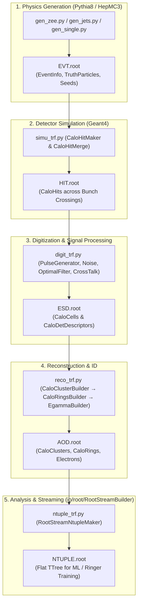

[](https://zenodo.org/badge/latestdoi/370090835)
[](https://github.com/lorenzetti-ufrj-br/lorenzetti/actions/workflows/pages.yml)
[](https://github.com/lorenzetti-ufrj-br/lorenzetti/actions/workflows/reco_sequence.yml)
[](https://github.com/lorenzetti-ufrj-br/lorenzetti/actions/workflows/anomaly_sequence.yml)

# Lorenzetti Framework

Lorenzetti is a modular High Energy Physics (HEP) simulation, digitization, and reconstruction framework developed for research and development in calorimeter signal processing, trigger algorithms, and machine learning applications.

Built upon **Geant4**, **Pythia8**, and **ROOT**, Lorenzetti models the complete calorimeter chain: from primary particle interactions and energy shower evolution to electronic pulse shaping, noise injection, cross-talk, optimal filtering (OF/COF), cluster reconstruction, and shower shape evaluation.

---

## 1. End-to-End Processing Pipeline



---

## 2. Repository Structure

| Directory | Scope |
| :--- | :--- |
| `core/` | Core framework infrastructure (`GaugiKernel`, `G4Kernel`, StoreGate `EventContext`, Data Handles). |
| `events/` | Event Data Model (EDM) classes (`CaloHit`, `CaloCell`, `CaloCluster`, `CaloRings`, `Egamma`, `EventInfo`). |
| `generator/` | Physics event generator interfaces and filters based on Pythia8 (`Zee`, `Jets`, `Minbias`, `SingleParticle`). |
| `geometry/` | Detector geometry construction, material definitions, and segmentation descriptors in Geant4. |
| `reconstruction/` | Digitization, pulse shaping, clustering, concentric ring summation, and electron identification. |
| `io/root/` | ROOT I/O streaming package (`RootStreamBuilder`) with dynamic auto-discovery reader and item-list writer. |
| `context/` | Framework constitution, architectural blueprints, quality gates, and subsystem specifications. |
| `examples/` | Production job cards, execution scripts, and multi-threaded processing utilities (`prun_jobs.py`). |

---

## 3. Calorimeter Geometry & Granularity

Lorenzetti implements a cylindrical $4\pi$ sampling calorimeter layout:

| System | Sampling Layer | Material (Absorber / Active) | Granularity ($\Delta\eta \times \Delta\phi$) |
| :--- | :---: | :--- | :---: |
| **ECAL (Barrel)** | 0 (Pre-Sampler) | Lead / Liquid Argon ($Pb / LAr$) | $0.025 \times 0.1$ |
| | 1 (Front Strips) | Lead / Liquid Argon ($Pb / LAr$) | $0.003125 \times 0.1$ |
| | 2 (Middle) | Lead / Liquid Argon ($Pb / LAr$) | $0.025 \times 0.025$ |
| | 3 (Back) | Lead / Liquid Argon ($Pb / LAr$) | $0.050 \times 0.025$ |
| **TileCal (Barrel)** | 1 (Front) | Iron / Scintillator ($Fe / \text{Scint.}$) | $0.1 \times 0.1$ |
| | 2 (Middle) | Iron / Scintillator ($Fe / \text{Scint.}$) | $0.1 \times 0.1$ |
| | 3 (Back) | Iron / Scintillator ($Fe / \text{Scint.}$) | $0.2 \times 0.1$ |
| **EMEC (EndCap)** | 0 (Pre-Sampler) | Lead / Liquid Argon ($Pb / LAr$) | $0.025 \times 0.1$ |
| | 1 (Front) | Lead / Liquid Argon ($Pb / LAr$) | $(0.003\text{--}0.006) \times 0.1$ |
| | 2 (Middle) | Lead / Liquid Argon ($Pb / LAr$) | $0.025 \times 0.025$ |
| | 3 (Back) | Lead / Liquid Argon ($Pb / LAr$) | $0.050 \times 0.025$ |
| **HEC (EndCap)** | 1--3 (All Layers) | Copper / Liquid Argon ($Cu / LAr$) | $0.1 \times 0.1 \text{ to } 0.2 \times 0.2$ |

---

## 4. Installation & Environment

### 4.1. Using Singularity / Docker (Recommended)

Pre-built container images contain the complete runtime stack (ROOT, Geant4, Pythia8, HepMC3, FastJet):

```bash
singularity pull docker://lorenzetti/lorenzetti:latest
singularity run lorenzetti_latest.sif
```

### 4.2. Local Build

```bash
git clone https://github.com/lorenzetti-ufrj-br/lorenzetti.git
cd lorenzetti
make
source build/lzt_setup.sh
```

---

## 5. Execution Example: $Z \to e^+e^-$ Sequence

```bash
# 1. Physics event generation
python generator/filters/scripts/gen_zee.py -o Zee.EVT.root --num-events 10

# 2. Geant4 detector simulation
python reconstruction/reco/scripts/simu_trf.py -i Zee.EVT.root -o Zee.HIT.root -nt 10

# 3. Calorimeter digitization and electronic signal simulation
python reconstruction/reco/scripts/digit_trf.py -i Zee.HIT.root -o Zee.ESD.root

# 4. Reconstruction (Clusters, Concentric Rings, Electrons)
python reconstruction/reco/scripts/reco_trf.py -i Zee.ESD.root -o Zee.AOD.root

# 5. Analysis Ntuple export
python reconstruction/reco/scripts/ntuple_trf.py -i Zee.AOD.root -o Zee.NTUPLE.root
```

---

## 6. Continuous Integration

| Test Suite | Scope | Status |
| :--- | :--- | :--- |
| **Core Build** | C++ compilation and library generation |  |
| **Reco Sequence** | Full $Z \to e^+e^-$ end-to-end chain (`EVT` $\to$ `NTUPLE`) |  |
| **Anomaly Sequence** | Anomaly injection and defect simulation |  |
| **Documentation** | Sphinx and Doxygen builds |  |

---

## 7. Citations

If you use Lorenzetti in your research, please cite:

> **Lorenzetti Showers: A general-purpose framework for supporting signal reconstruction and triggering with calorimeters**  
> *Computer Physics Communications*, Volume 286, 2023, 108671.  
> DOI: [10.1016/j.cpc.2023.108671](https://doi.org/10.1016/j.cpc.2023.108671)

---

## 8. License

This project is licensed under the **GNU General Public License v3.0 (GPLv3)**. See the [LICENSE](LICENSE) file for details.
