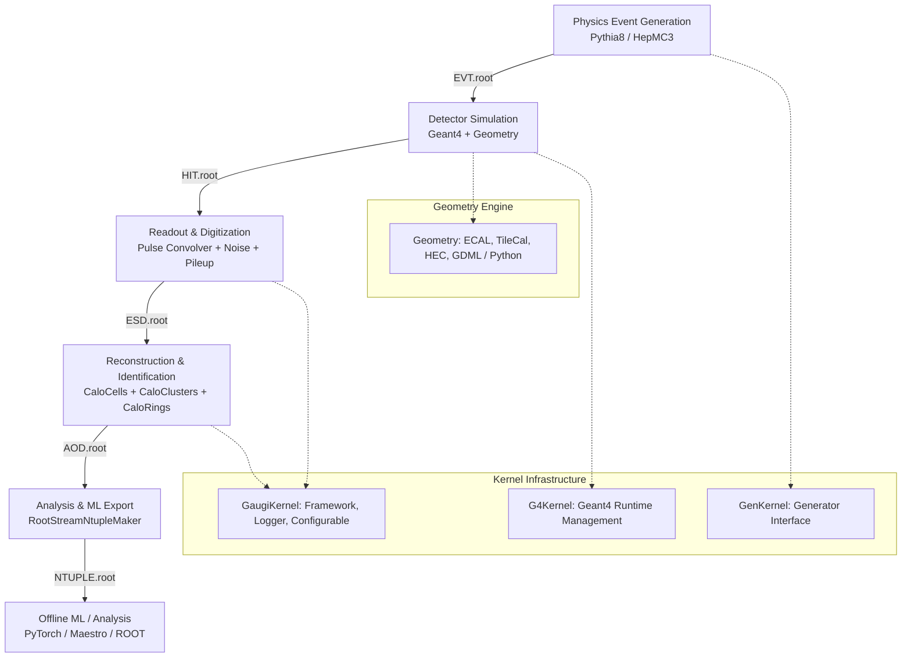

# 🏗️ Lorenzetti System Architecture

> **Status:** Active Reference  
> **Scope:** High-level system design, Event Data Model (EDM), processing pipeline, and C++/Python integration.

---

## 1. High-Level System Architecture

Lorenzetti is structured into decoupled, layered subsystems:



---

## 2. Event Data Model (EDM) Lifecycle

The processing pipeline transitions data through standardized ROOT storage tiers:

| Tier | Format Name | Description | Key Objects |
| :--- | :--- | :--- | :--- |
| **EVT** | Event Generation | Primary vertex, generated particles, stable decay products, kinematic truth. | `EventInfo`, `TruthParticleContainer` |
| **HIT** | Geant4 Energy Hits | Step-level energy deposits in active/passive calorimeter samplings with $(x,y,z,t)$ coordinates. | `CaloHitContainer`, `TruthParticleContainer` |
| **ESD** | Event Summary Data | Digitized samples, reconstructed energy and time per cell, electronic noise, defect flags. | `CaloCellContainer`, `CaloDetDescriptorContainer` |
| **AOD** | Analysis Object Data | Reconstructed physics objects (clusters, rings, candidate e/gamma objects, tracking spacepoints). | `CaloClusterContainer`, `CaloRingsContainer`, `EgammaContainer`, `SpacePointContainer` |
| **NTUPLE**| Flat Analysis Tree | TTree containing flattened vectors for direct consumption by Python ML frameworks (NumPy, PyTorch, Pandas). | Flat branches (`el_et`, `el_eta`, `el_phi`, `el_rings`, `cell_e`, `truth_pdgId`) |

---

## 3. C++ and Python Dual-Layer Architecture

Lorenzetti leverages a hybrid design:
- **C++ Core (`liblorenzetti.so`)**: Handles compute-intensive physics: Geant4 particle tracking, pulse shaping convolutions, sliding window clustering, and ROOT streaming I/O.
- **Python Steering Layer (`reco`, `generator`, `geometry`)**: Provides declarative job configuration, parameter sweeps, multiprocessing orchestration (`joblib`), and user-friendly CLI tools via `typer`.

### 3.1. GaugiKernel Binding Pattern
1. **`Configurable` base class**: Python classes mirror C++ algorithm properties using key-value attribute setters:
   ```python
   class CaloCellMaker(Configurable):
       def __init__(self, name: str, **kwargs: Any) -> None:
           super().__init__(name, **kwargs)
           self.declare_property("OutputLevel", LoggingLevel.INFO)
           self.declare_property("NoiseStd", 0.0)
   ```
2. **`EventTape` / `ComponentAccumulator`**: Coordinates the event loop, algorithm sequence, and input/output streams.
3. **ROOT Dictionaries & PCM**: Every EDM and Tool class has generated CINT dictionaries, enabling seamless object instantiation and manipulation directly in Python via `ROOT.gSystem.Load("liblorenzetti")`.

---

## 4. Module Decomposition & Dependency Graph

| Directory | Submodules | Purpose | Dependencies |
| :--- | :--- | :--- | :--- |
| **`core/`** | `GaugiKernel`, `G4Kernel`, `GenKernel` | Core execution framework, logging, Geant4 bridges, generator interfaces. | ROOT, Geant4, Pythia8, HepMC3 |
| **`events/`** | `CaloHit`, `CaloCell`, `SpacePoint`, `CaloCluster`, `EventInfo`, `TruthParticle`, `CaloRings`, `Egamma` | Standard Event Data Model (EDM) definitions and ROOT serializers. | ROOT, GaugiKernel |
| **`geometry/`** | `src`, `python`, `data` | Cylindrical 4π calorimeter description (ECAL Barrel/EndCap, TileCal, HEC), material budgets, detector descriptors. | Geant4, ROOT, GaugiKernel |
| **`generator/`** | `genkernel`, `filters`, `evtgen` | Physics event generators (Z $\to ee$, QCD dijets, Minimum Bias, single particles) and acceptance filters. | Pythia8, HepMC3, GaugiKernel, GenKernel |
| **`reconstruction/`** | `calorimeter`, `physics`, `io`, `reco`, `tracking` | Signal processing (pulse shapes, noise, OF/COF, defects), clustering, Ringer rings, e/gamma identification, transforms (`*_trf.py`). | Geant4, ROOT, GaugiKernel, events, geometry |
| **`docker/`** | `Dockerfile`, `Makefile`, `requirements.txt` | Reproducible execution environment containerization (Singularity / Docker). | Ubuntu 22.04 base, ROOT, Geant4, Pythia8, FastJet |

---

## 5. Data Flow & Algorithmic Chain

```
[Pythia8 Generation]
         │ (Kinematic Truth)
         ▼
[Geant4 Simulation (G4RunManager)]
         │ (CaloHit with dE/dx & Time)
         ▼
[Digitization (PulseGenerator + Noise + CrossTalk + Defects)]
         │ (Samples convolved with shaper)
         ▼
[Optimal Filtering (OF / COF Energy & Time Reconstruction)]
         │ (CaloCell with E & t)
         ▼
[Topological / Sliding Window Clustering (CaloClusterMaker)]
         │ (CaloCluster in Δη × Δφ)
         ▼
[Ringer Feature Extraction (CaloRingsMaker)]
         │ (Concentric Energy Rings per layer)
         ▼
[Egamma Candidate Building & Flat Ntuple Export (RootStreamNtupleMaker)]
```
