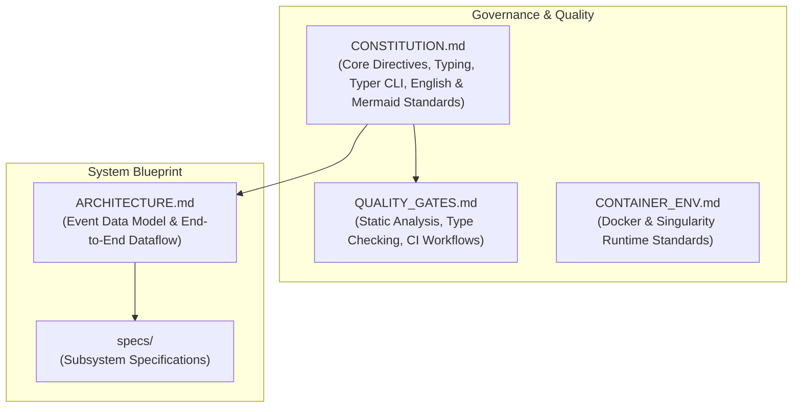

# 📖 Lorenzetti Framework Context & Specifications Hub

> **Status:** Active Knowledge Base & Technical Blueprint  
> **Target Audience:** Maintainers, Developers, Particle Physics Researchers, and Automated Agents.

---

## 🧭 Navigation & Overview

This directory (`context/`) forms the **governance, architectural foundation, and technical specification** for the Lorenzetti calorimetry simulation and reconstruction framework.

```
context/
├── 📜 CONSTITUTION.md         # Non-negotiable technical rules, standards, and directives
├── 🏗️ ARCHITECTURE.md          # Global architecture, Event Data Model (EDM), and dataflow
├── 🐳 CONTAINER_ENV.md        # Singularity/Docker environment, standard ENVs, and workflows
├── 🛡️ QUALITY_GATES.md         # Formatting, typing, CLI validation, and pre-commit checks
└── 📁 specs/
    ├── ⚙️ core_spec.md        # GaugiKernel, G4Kernel, GenKernel specifications
    ├── 📦 events_spec.md      # Event Data Model (CaloHit, CaloCell, CaloCluster, CaloRings, Egamma)
    ├── 📐 geometry_spec.md    # Calorimeter detector layout, granularity, and Geant4 volumes
    ├── ⚛️ generator_spec.md   # Pythia8 event generation, filters (Zee, Jets, Minbias, Single)
    ├── 🔬 reconstruction_spec.md # Digitization, pulse shaping, noise, Optimal Filtering, clustering
    ├── 🖥️ cli_standards.md    # Typer CLI standards, option naming, and migration guide
    └── 🔄 ci_cd_spec.md       # GitHub Actions workflows and CI validation suites
```

---



---

## ⚡ Core Directives Summary

1. **English Language Mandatory**: All documentation, package READMEs, docstrings, and comments must be in English.
2. **Standardized Mermaid Visuals**: All package READMEs must include clean, structured Mermaid diagrams following the RootStreamBuilder style (`graph TD` with logical `subgraph` sections).
3. **Python Strict Type Hinting**: Mandatory typing using `typing` (`Dict`, `List`, `Optional`, `Union`, `Tuple`, `Any`). Every function and method must declare return types.
4. **Typer for All CLIs**: All executable scripts in `scripts/` must be implemented with `typer` (replacing legacy `argparse`).
5. **Markdown Documentation**: All docstrings, inline technical explanations, and package READMEs must use clear Markdown formatting.
6. **Singularity/Docker Container Execution**: The framework compiles and executes within a container base image (`docker://lorenzetti/lorenzetti:latest`) relying on standardized project environment variables (`LORENZETTI_*`, `ROOTSYS`, `GEANT4_*`, `PYTHIA8_*`).
