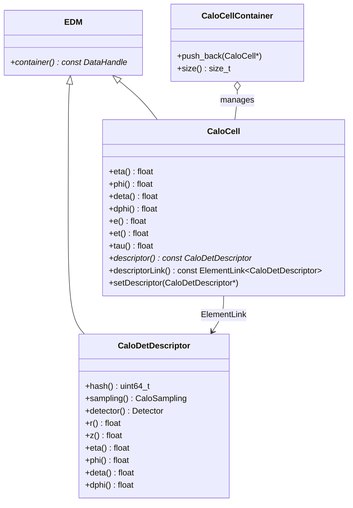

# CaloCell

**Calorimeter Readout Cells & Detector Descriptors**

The `CaloCell` package models discrete calorimeter readout channels. It groups microscopic energy hits into digitized signals, attaches electronic pulse properties, and links directly to detailed spatial geometry descriptors (`CaloDetDescriptor`).

---

## 1. Class Structure & Relationships



---

## 2. Key Attributes

### `xAOD::CaloCell`
- **Spatial Positioning**: $\eta$, $\phi$, $\Delta\eta$, $\Delta\phi$.
- **Energy Metrics**: Total deposited energy `e()`, transverse energy `et()`.
- **Pulse Timing**: Signal pulse delay/time-of-flight `tau()`.
- **Geometry Link**: `descriptor()` lazily resolved through `SG::ElementLink<CaloDetDescriptor>`.

### `xAOD::CaloDetDescriptor`
Provides offline geometry lookup:
- Radial distance $r$ / longitudinal position $z$.
- Subdetector enum (`Detector::LAr`, `Detector::Tile`) and sampling layer (`CaloSampling`).
- Unique hardware identifier hash.

---

## 3. Usage Example (C++)

```cpp
#include "CaloCell/CaloCell.h"
#include "CaloCell/CaloDetDescriptor.h"
#include "CaloCell/CaloCellContainer.h"

// Create a calorimeter readout cell
xAOD::CaloCell* cell = new xAOD::CaloCell(0.15f, 1.20f, 0.025f, 0.025f);
cell->setE(15420.5f);  // 15.42 GeV in MeV
cell->setEt(15230.1f);
cell->setTau(2.1f);    // Time of flight (ns)

// Associate with a detector descriptor
const xAOD::CaloDetDescriptor* desc = ...;
cell->setDescriptor(desc);

// Query cell geometry
if (cell->descriptor()) {
    std::cout << "Cell detector hash: " << cell->descriptor()->hash() << std::endl;
}

// Store in container
auto* cellContainer = new xAOD::CaloCellContainer();
cellContainer->push_back(cell);
```

---

## 4. Python Usage

```python
from CaloCell import CaloCell, CaloCellContainer

cell = CaloCell(0.2, 1.5, 0.025, 0.025)
cell.setE(25000.0)
print(f"Cell Energy: {cell.e()} MeV, Eta: {cell.eta()}")
```
