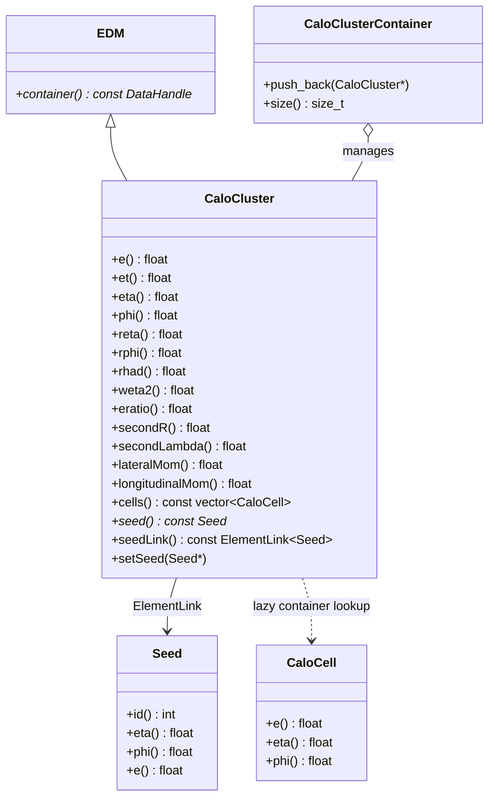
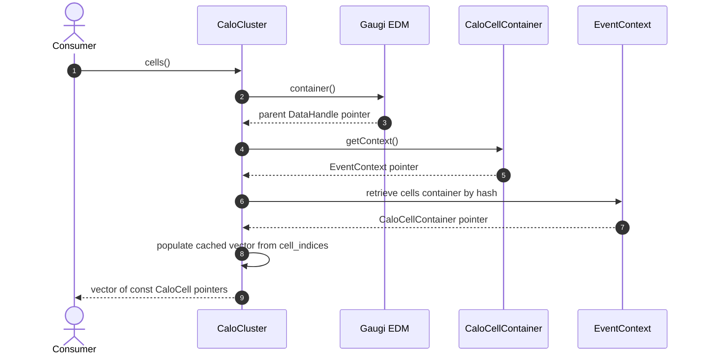

# CaloCluster

**Calorimeter Energy Clusters, Shower Shapes & Spatial Moments**

The `CaloCluster` package defines `xAOD::CaloCluster`, the central reconstruction object representing energy showers in the electromagnetic and hadronic calorimeters. It computes shower shape variables, spatial cluster moments, connects to simulation RoI seeds, and provides lazy-evaluated access to its constituent cells.

---

## 1. Class Structure & Relationships



---

## 2. Shower Shapes & Discriminants

`xAOD::CaloCluster` computes standard ATLAS-style shower shape variables used in particle identification:

| Variable | Description |
| :--- | :--- |
| `reta()` ($R_\eta$) | Energy ratio in $\eta$: $E_{3\times 7} / E_{7\times 7}$ in the second EM sampling layer. |
| `rphi()` ($R_\phi$) | Energy ratio in $\phi$: $E_{3\times 3} / E_{3\times 7}$ in the second EM sampling layer. |
| `weta2()` ($w_{\eta2}$) | Lateral shower width in the second EM layer. |
| `rhad()` / `rhad1()` | Ratio of transverse energy in the first hadronic layer to EM transverse energy ($E_T^{\text{Had}} / E_T^{\text{EM}}$). |
| `eratio()` ($E_{\text{ratio}}$)| Ratio of energy difference between first two maxima to their sum in the first EM layer (strips). |
| `lateralMom()` | Second lateral moment describing lateral shower spread. |
| `longitudinalMom()` | Second longitudinal moment describing shower penetration depth. |

---

## 3. Lazy Cell Resolution

Rather than storing raw pointers to hundreds of cells, each `CaloCluster` holds the `cells_key_hash` and integer `cell_indices`. When `cluster->cells()` is called:



---

## 4. Usage Example (C++)

```cpp
#include "CaloCluster/CaloCluster.h"
#include "CaloCluster/CaloClusterContainer.h"
#include "EventInfo/Seed.h"

// Instantiate cluster
xAOD::CaloCluster* cluster = new xAOD::CaloCluster(
    18000.0f,  // emaxs2 (MeV)
    0.35f,     // eta
    1.22f,     // phi
    0.025f,    // deta
    0.025f     // dphi
);

cluster->setE(45000.0f);  // 45 GeV
cluster->setEt(42500.0f);
cluster->setReta(0.965f);
cluster->setRphi(0.942f);
cluster->setWeta2(0.0112f);
cluster->setRhad(0.008f);

// Link to truth RoI seed
const xAOD::Seed* seed = ...;
cluster->setSeed(seed);

// Access linked seed
if (cluster->seed()) {
    std::cout << "Associated Seed ID: " << cluster->seed()->id() << std::endl;
}

// Store in container
auto* clusterContainer = new xAOD::CaloClusterContainer();
clusterContainer->push_back(cluster);
```
