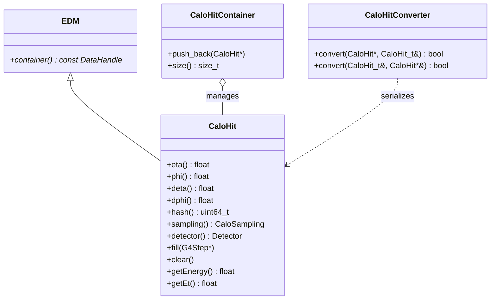

# CaloHit

**Geant4 Sensitive Calorimeter Energy Depositions**

The `CaloHit` package defines `xAOD::CaloHit`, which represents microscopic ionization and shower energy depositions created by Geant4 simulation particles passing through sensitive active detector media (e.g. Liquid Argon, scintillating tiles).

---

## 1. Class Structure & Relationships



---

## 2. Key Features

- **Geant4 Integration**: Direct `fill(const G4Step*)` method extracting energy loss $dE/dx$, spatial coordinates $(\eta, \phi)$, and arrival timestamps.
- **Detector Sampling**: Mapped to calorimeter sampling layers (`PreSamplerB`, `EMB1`, `EMB2`, `EMB3`, `TileBar0`, `TileExt0`, etc.) defined in `CaloCell/enumeration.h`.
- **Pulse Vectors**: Holds multi-bunch crossing pulse time profiles (`bc_duration`, `bcid_start`, `bcid_end`) to model out-of-time pileup.

---

## 3. Usage Example (C++)

```cpp
#include "CaloHit/CaloHit.h"
#include "CaloHit/CaloHitContainer.h"

// Instantiate a new sensitive hit
xAOD::CaloHit* hit = new xAOD::CaloHit(
    0.25,                  // eta
    1.52,                  // phi
    0.025,                 // deta
    0.025,                 // dphi
    12345678,              // detector geometry hash
    CaloSampling::EMB2,    // calorimeter sampling
    Detector::LAr,         // subdetector type
    25.0,                  // bunch crossing duration (ns)
    -2,                    // bcid start
    2                      // bcid end
);

// During Geant4 simulation step:
// hit->fill(step);

// Store in container
auto* hitContainer = new xAOD::CaloHitContainer();
hitContainer->push_back(hit);
```

---

## 4. Serialization

The package includes `CaloHitConverter` and `CaloHit_t` for translating persistent C++ objects to and from flat ROOT structures.
