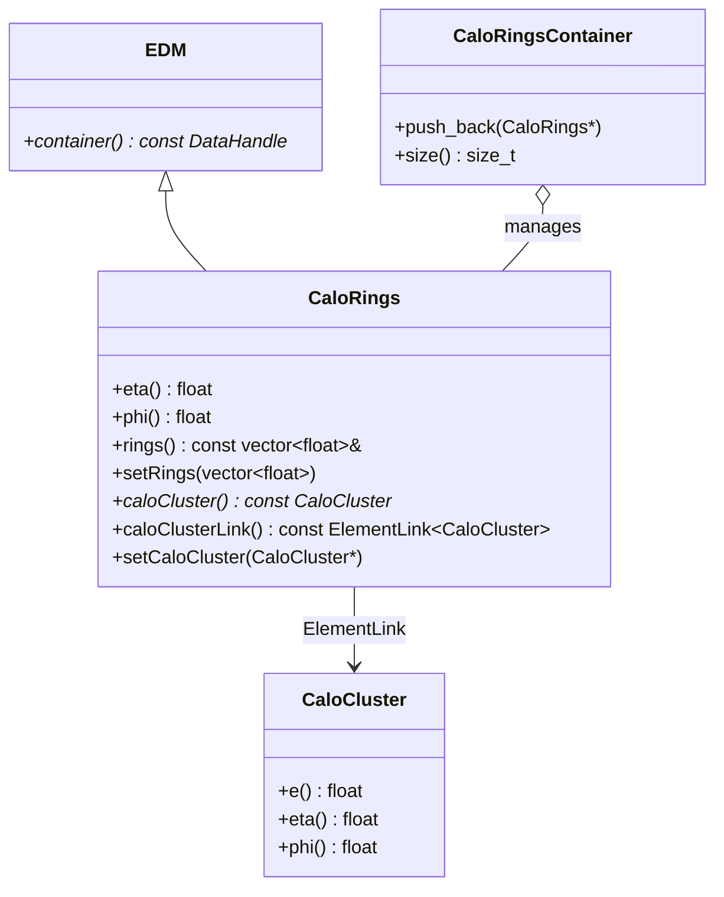
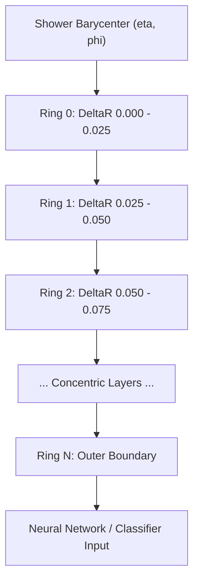

# CaloRings

**Concentric Calorimeter Rings for ML & Ringer Hypothesis Testing**

The `CaloRings` package encapsulates concentric $\eta-\phi$ calorimeter ring energy profiles (the **Ringer algorithm**). By summing cell energies in concentric spatial rings across sampling layers around an electron/photon candidate, full 3D shower profiles are condensed into a compact feature vector ideal for real-time neural networks and machine learning hypothesis testing.

---

## 1. Class Structure & Relationships



---

## 2. Ring Geometry Concept



- Energy from calorimeter cells within each sampling layer (PreSampler, EM1, EM2, EM3, Had1, Had2, Had3) is summed into concentric rings centered at the cluster barycenter:
  $$r = \sqrt{(\eta_{\text{cell}} - \eta_{\text{cluster}})^2 + (\phi_{\text{cell}} - \phi_{\text{cluster}})^2}$$
- Produces a fixed-length normalized vector (e.g. 100 ring features) directly consumable by neural network classifiers without variable-length graph/point-cloud overhead.

---

## 3. Usage Example (C++)

```cpp
#include "CaloRings/CaloRings.h"
#include "CaloRings/CaloRingsContainer.h"
#include "CaloCluster/CaloCluster.h"

xAOD::CaloRings* rings = new xAOD::CaloRings();
rings->setEta(0.25f);
rings->setPhi(1.52f);

// Fill 100 ring energy values (MeV)
std::vector<float> ringEnergies(100, 0.0f);
ringEnergies[0] = 12500.0f; // Core energy
ringEnergies[1] = 8400.0f;
ringEnergies[2] = 3200.0f;
rings->setRings(ringEnergies);

// Associate with parent CaloCluster
const xAOD::CaloCluster* cluster = ...;
rings->setCaloCluster(cluster);

// Retrieve parent cluster through ElementLink
if (rings->caloCluster()) {
    std::cout << "Cluster Energy: " << rings->caloCluster()->e() << " MeV" << std::endl;
}

// Store in container
auto* ringsContainer = new xAOD::CaloRingsContainer();
ringsContainer->push_back(rings);
```

---

## 4. Python Usage

```python
from CaloRings import CaloRings, CaloRingsContainer

rings = CaloRings()
rings.setEta(0.25)
rings.setPhi(1.52)
rings.setRings([12500.0, 8400.0, 3200.0])

print(f"Total Ring Features: {len(rings.rings())}")
```
