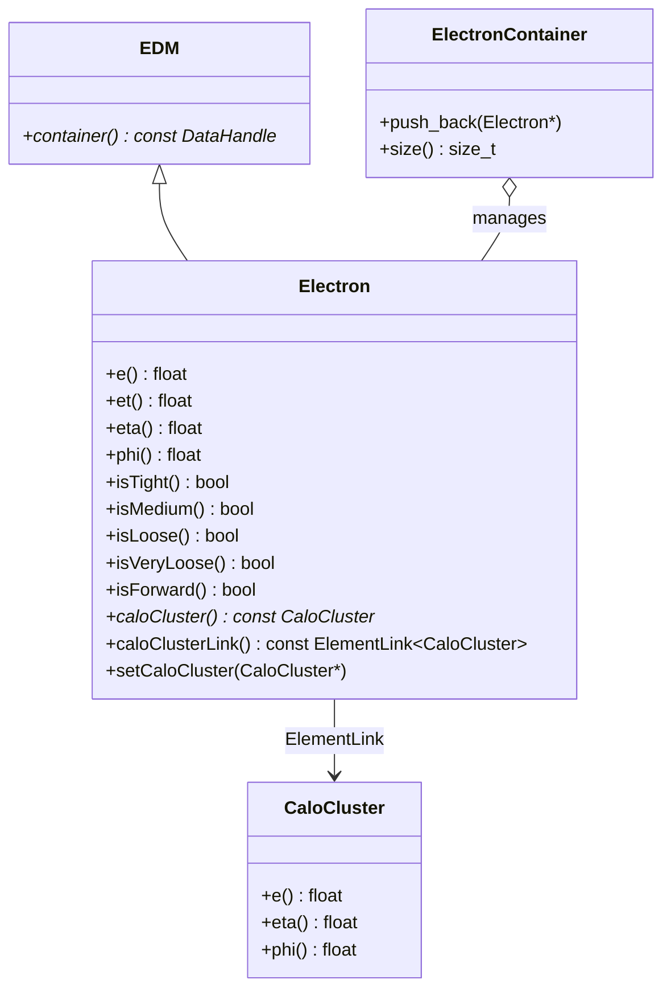

# Egamma

**Reconstructed Electron & Photon Physics Objects**

The `Egamma` package models reconstructed electron and photon candidates (`xAOD::Electron`). It combines calorimeter cluster shower measurements, tracking information, identification quality working points (Loose, Medium, Tight), and forward electron classification.

---

## 1. Class Structure & Relationships



---

## 2. Key Attributes & Methods

- **Kinematics**: Total energy `e()`, transverse energy `et()`, pseudorapidity `eta()`, azimuthal angle `phi()`.
- **Identification Selectors (PID)**:
  - `isVeryLoose()`: Minimal requirements for high-efficiency baseline studies.
  - `isLoose()`: Standard loose cut/likelihood selection.
  - `isMedium()`: Balanced efficiency and background rejection.
  - `isTight()`: High-purity electron selection for precision physics (e.g. $Z \to ee$).
- **Acceptance Regions**:
  - `isForward()`: Returns `true` if $|\eta| > 2.5$ (forward calorimeter region outside inner tracking coverage).
- **Cluster Link**: `caloCluster()` resolved via `SG::ElementLink<CaloCluster>`.

---

## 3. Usage Example (C++)

```cpp
#include "Egamma/Electron.h"
#include "Egamma/ElectronContainer.h"
#include "CaloCluster/CaloCluster.h"

xAOD::Electron* el = new xAOD::Electron();
el->setE(45000.0f);   // 45 GeV in MeV
el->setEt(42500.0f);  // 42.5 GeV
el->setEta(0.35f);
el->setPhi(1.22f);

// Set PID working points
el->setIsLoose(true);
el->setIsMedium(true);
el->setIsTight(true);

// Link to parent reconstructed cluster
const xAOD::CaloCluster* cluster = ...;
el->setCaloCluster(cluster);

// Access cluster properties through ElementLink
if (el->caloCluster()) {
    std::cout << "Matched Cluster Reta: " << el->caloCluster()->reta() << std::endl;
}

// Add to container
auto* elContainer = new xAOD::ElectronContainer();
elContainer->push_back(el);
```

---

## 4. Python Usage

```python
from Egamma import Electron, ElectronContainer

el = Electron()
el.setE(45000.0)
el.setEt(42500.0)
el.setEta(0.35)
el.setPhi(1.22)
el.setIsTight(True)

print(f"Electron pT: {el.et()/1000.0:.1f} GeV, isTight: {el.isTight()}, isForward: {el.isForward()}")
```
