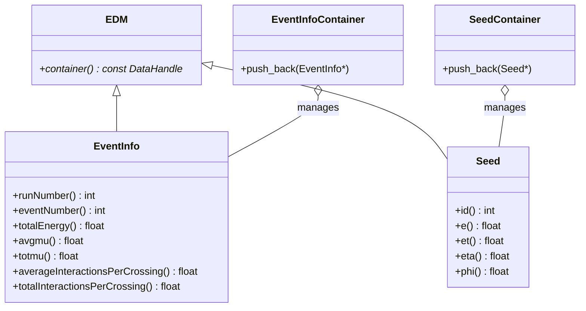

# EventInfo

**Event Metadata, Pileup & Simulation Seeds**

The `EventInfo` package provides high-level run and event-level context, pileup interaction counters, and simulation RoI seeds (`xAOD::Seed`).

---

## 1. Class Structure & Relationships



---

## 2. Key Entities

### `xAOD::EventInfo`
Holds global metadata for the current simulation/reconstruction event:
- **Run & Event Number**: `runNumber()`, `eventNumber()`.
- **Pileup Metrics**:
  - `avgmu()` / `averageInteractionsPerCrossing()`: Expected average pileup parameter $\langle\mu\rangle$ from Pythia8 minimum bias configuration.
  - `totmu()` / `totalInteractionsPerCrossing()`: Actual Poisson-distributed total inelastic collisions generated for this bunch crossing.
- **Total Energy**: `totalEnergy()` across the collision.

### `xAOD::Seed`
Represents generator-level Regions of Interest (RoIs) or particle seeds:
- Identifier `id()`.
- Seed energy `e()` and transverse energy `et()`.
- Spatial centroid coordinates: `eta()`, `phi()`.
- Targets of `SG::ElementLink<Seed>` from `TruthParticle` and `CaloCluster`.

---

## 3. Usage Example (C++)

```cpp
#include "EventInfo/EventInfo.h"
#include "EventInfo/Seed.h"
#include "EventInfo/EventInfoContainer.h"
#include "EventInfo/SeedContainer.h"

// Set up event metadata
xAOD::EventInfo* info = new xAOD::EventInfo();
info->setRunNumber(1001);
info->setEventNumber(42);
info->setAvgmu(60.0f);  // High-luminosity LHC average pileup
info->setTotmu(63.0f);  // Actual collisions in this event

// Create a truth RoI seed
xAOD::Seed* seed = new xAOD::Seed(
    0,         // seed ID
    45000.0f,  // energy (MeV)
    42000.0f,  // et (MeV)
    0.35f,     // eta
    1.22f      // phi
);

// Manage in containers
auto* infoContainer = new xAOD::EventInfoContainer();
infoContainer->push_back(info);

auto* seedContainer = new xAOD::SeedContainer();
seedContainer->push_back(seed);
```

---

## 4. Python Usage

```python
from EventInfo import EventInfo, Seed

info = EventInfo()
info.setRunNumber(2026)
info.setEventNumber(1)
info.setAvgmu(45.0)

print(f"Run {info.runNumber()}, Event {info.eventNumber()}, <mu> = {info.avgmu()}")
```
