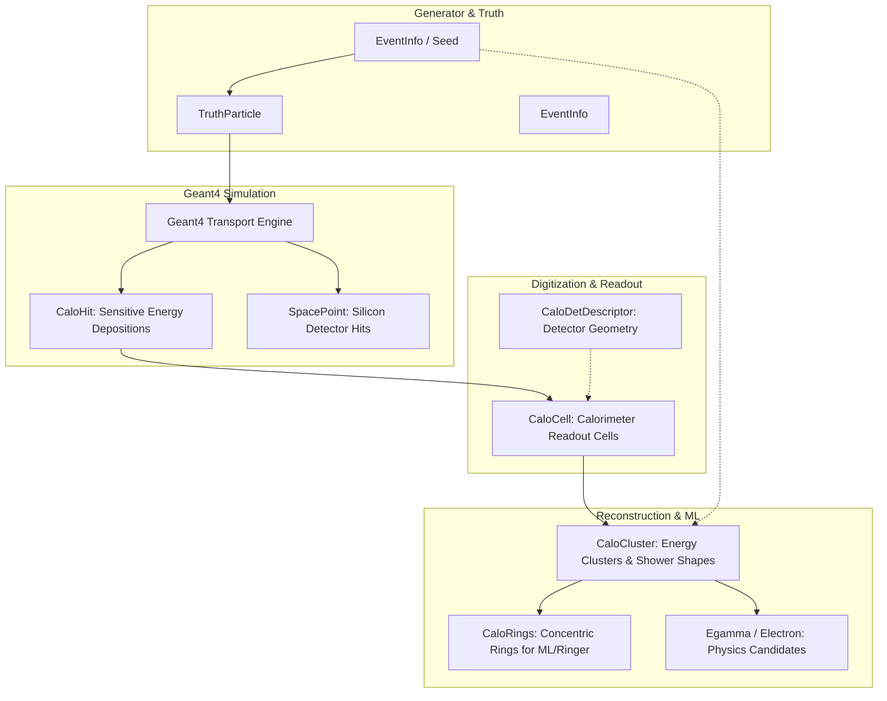
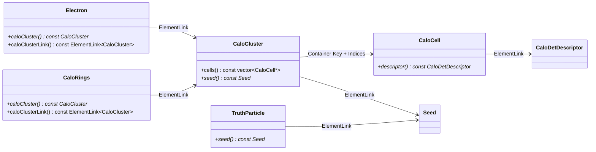

# Events Package Architecture (EDM)

**Event Data Model (xAOD / EDM) of the Lorenzetti Simulation Platform**

The `events/` directory contains all data definitions and containers representing the physics and detector information throughout simulation, digitization, and reconstruction. Each subpackage defines an **xAOD** (Analysis Object Data) entity that inherits from `Gaugi::EDM` and participates in the relational event bus via `SG::ElementLink`.

---

## 1. Event Data Model Flow

The reconstruction and simulation pipeline transforms Monte Carlo generated truth into simulated energy hits, digitized cells, reconstructed clusters, and physics analysis objects:

---

## 2. Relational Object Navigation (`ElementLink`)

Lorenzetti eliminates raw pointer fragility and global state by implementing `SG::ElementLink<T>` across all reconstructed objects:

---

## 3. Subpackages Summary

| Package | Core Classes | Primary Purpose |
| :--- | :--- | :--- |
| [**`CaloHit`**](file:///home/joao.pinto/git_repos/lorenzetti/events/CaloHit/README.md) | `xAOD::CaloHit`, `CaloHitContainer` | Geant4 energy depositions in sensitive calorimeter elements. |
| [**`CaloCell`**](file:///home/joao.pinto/git_repos/lorenzetti/events/CaloCell/README.md) | `xAOD::CaloCell`, `xAOD::CaloDetDescriptor` | Calorimeter readout cells with electronic shaping and geometry descriptors. |
| [**`SpacePoint`**](file:///home/joao.pinto/git_repos/lorenzetti/events/SpacePoint/README.md) | `xAOD::SpacePoint`, `SpacePointContainer` | 3D $(x,y,z)$ silicon tracker space points for track reconstruction. |
| [**`CaloCluster`**](file:///home/joao.pinto/git_repos/lorenzetti/events/CaloCluster/README.md) | `xAOD::CaloCluster`, `CaloClusterContainer` | Reconstructed energy clusters, shower shapes ($R_\eta, R_\phi$), and moments. |
| [**`CaloRings`**](file:///home/joao.pinto/git_repos/lorenzetti/events/CaloRings/README.md) | `xAOD::CaloRings`, `CaloRingsContainer` | Concentric $\eta-\phi$ calorimeter ring energy profiles (Ringer ML algorithm). |
| [**`Egamma`**](file:///home/joao.pinto/git_repos/lorenzetti/events/Egamma/README.md) | `xAOD::Electron`, `ElectronContainer` | Reconstructed electron candidates with identification working points. |
| [**`EventInfo`**](file:///home/joao.pinto/git_repos/lorenzetti/events/EventInfo/README.md) | `xAOD::EventInfo`, `xAOD::Seed` | Event metadata (run, event, pileup $\langle\mu\rangle$) and RoI generator seeds. |
| [**`TruthParticle`**](file:///home/joao.pinto/git_repos/lorenzetti/events/TruthParticle/README.md) | `xAOD::TruthParticle`, `TruthParticleContainer` | Generator-level Monte Carlo truth particles (4-momenta, vertex, PDG ID). |

---

## 4. Common EDM Interfaces & Conventions

Every EDM entity inherits from `Gaugi::EDM`:
- **`container()`**: Returns the parent `SG::DataHandle*` managing the collection.
- **Lazy Resolution**: Relational navigation via `ElementLink` automatically queries the parent container's `EventContext` to locate target objects by 64-bit key hash and index.
- **Serialization**: Each package provides a `<Name>Converter` and `<Name>_t` flat struct for direct serialization into ROOT trees and flat tuples.
