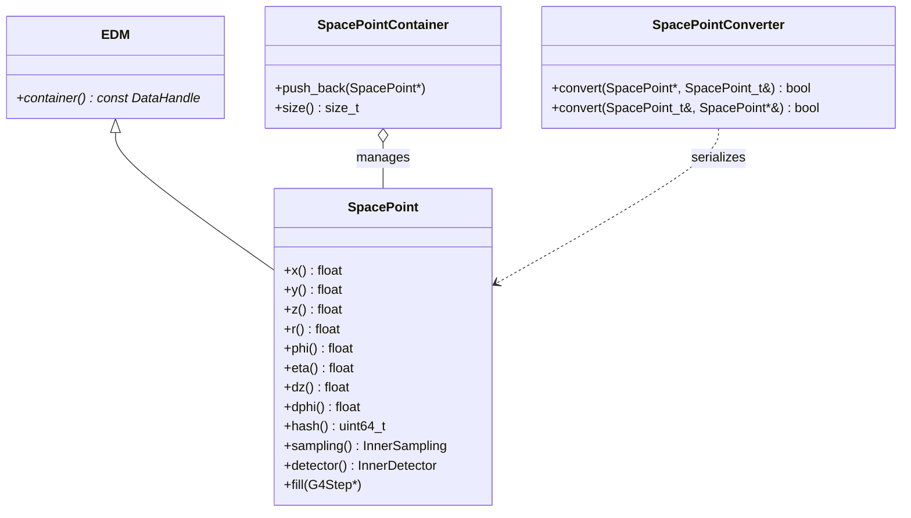

# SpacePoint

**Inner Detector Silicon 3D Reconstruction Points**

The `SpacePoint` package models 3D reconstructed position hits $(x, y, z)$ within the silicon Inner Detector (pixel detector and strip tracker). These points form the essential inputs for tracking, seed finding, and track reconstruction.

---

## 1. Class Structure & Relationships



---

## 2. Key Attributes

- **Cartesian Coordinates**: $x, y, z$ in millimeters.
- **Cylindrical Coordinates**: Computed radius $r = \sqrt{x^2 + y^2}$, azimuthal angle $\phi = \text{atan2}(y, x)$, and pseudorapidity $\eta$.
- **Uncertainties / Segment Sizes**: $\Delta z$, $\Delta\phi$.
- **Detector Layer**: Subdetector enum (`Pixel`, `SCT`) and sampling index (`InnerSampling::PixelBarrel0`, `PixelBarrel1`, `SCTBarrel0`, etc.).

---

## 3. Usage Example (C++)

```cpp
#include "SpacePoint/SpacePoint.h"
#include "SpacePoint/SpacePointContainer.h"

// Instantiate a tracker space point
xAOD::SpacePoint* sp = new xAOD::SpacePoint(
    50.5f,                       // x (mm)
    87.3f,                       // y (mm)
    -120.4f,                     // z (mm)
    1.045f,                      // phi (rad)
    0.1f,                        // dz
    0.001f,                      // dphi
    987654321,                   // detector module hash
    InnerSampling::PixelBarrel0, // layer sampling
    InnerDetector::Pixel,        // subdetector
    25.0f,                       // bc duration (ns)
    0,                           // bcid start
    0                            // bcid end
);

// Access cylindrical variables
std::cout << "SpacePoint Radius: " << sp->r() << " mm, Eta: " << sp->eta() << std::endl;

// Manage in collection
auto* spContainer = new xAOD::SpacePointContainer();
spContainer->push_back(sp);
```
