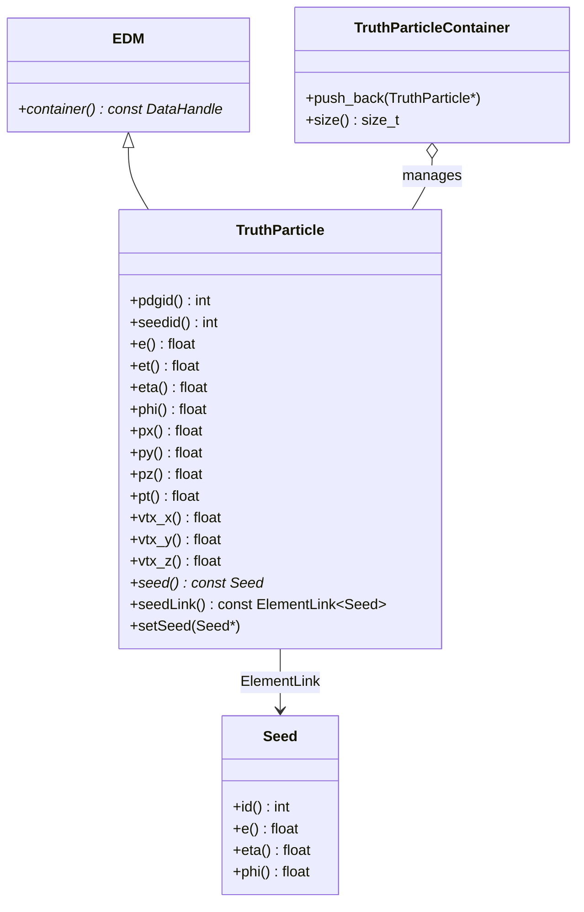

# TruthParticle

**Monte Carlo Generator Truth Particles & Kinematics**

The `TruthParticle` package defines `xAOD::TruthParticle`, representing primary generated particles from event generators (Pythia8, HepMC3). It stores full particle kinematics ($p_x, p_y, p_z, E$), production vertex coordinates, PDG identification codes, and links to simulation seeds.

---

## 1. Class Structure & Relationships



---

## 2. Key Attributes & Methods

- **Particle Identification**:
  - `pdgid()`: Standard Particle Data Group integer code (e.g. $11$ for $e^-$, $-11$ for $e^+$, $22$ for $\gamma$, $23$ for $Z^0$).
  - `seedid()`: Identifier matching the generator seed index.
- **4-Momentum Kinematics**:
  - Energy: `e()`, transverse energy `et()`.
  - Cartesian momentum components: `px()`, `py()`, `pz()`.
  - Transverse momentum: `pt() = std::sqrt(px*px + py*py)`.
  - Spatial angles: pseudorapidity `eta()`, azimuthal angle `phi()`.
- **Production Vertex**:
  - Spatial coordinates: `vtx_x()`, `vtx_y()`, `vtx_z()` (mm).
- **Seed Link**:
  - `seed()`: Access the linked truth RoI seed via `SG::ElementLink<Seed>`.

---

## 3. Usage Example (C++)

```cpp
#include "TruthParticle/TruthParticle.h"
#include "TruthParticle/TruthParticleContainer.h"
#include "EventInfo/Seed.h"

// Instantiate electron truth particle (PDGID = 11)
xAOD::TruthParticle* part = new xAOD::TruthParticle(
    11,        // PDG ID (electron)
    0,         // seed ID
    45000.0f,  // E (MeV)
    42000.0f,  // Et (MeV)
    0.35f,     // eta
    1.22f,     // phi
    14500.0f,  // px (MeV)
    39400.0f,  // py (MeV)
    15800.0f,  // pz (MeV)
    0.0f,      // vertex x (mm)
    0.0f,      // vertex y (mm)
    -12.4f     // vertex z (mm)
);

// Link to RoI Seed
const xAOD::Seed* seed = ...;
part->setSeed(seed);

// Query truth properties
std::cout << "Truth Particle PDGID: " << part->pdgid() 
          << ", pT: " << part->pt() / 1000.0f << " GeV" << std::endl;

// Store in container
auto* truthContainer = new xAOD::TruthParticleContainer();
truthContainer->push_back(part);
```

---

## 4. Python Usage

```python
from TruthParticle import TruthParticle, TruthParticleContainer

part = TruthParticle(11, 0, 45000.0, 42000.0, 0.35, 1.22, 14500.0, 39400.0, 15800.0, 0.0, 0.0, -12.4)
print(f"PDG: {part.pdgid()}, E: {part.e()/1000.0:.1f} GeV, Pt: {part.pt()/1000.0:.1f} GeV")
```
