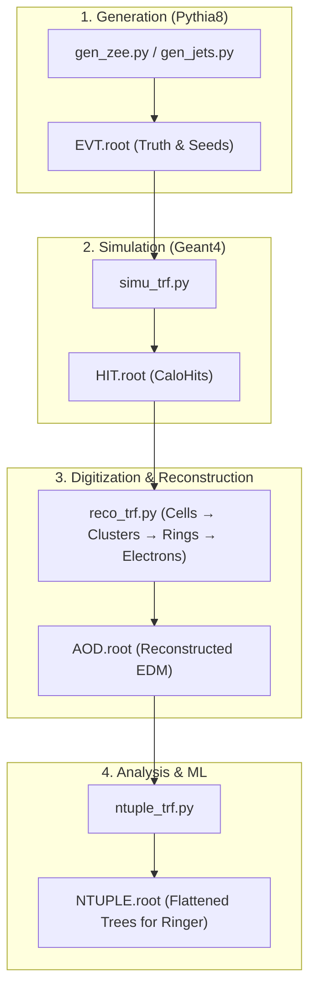

# Lorenzetti Examples & Execution Guide

This directory contains production job cards, transform templates, and examples demonstrating how to run the full simulation and reconstruction sequence.

---

## 1. End-to-End Simulation & Reconstruction Workflow



---

## 2. Running a Production Chain from Scratch

### 2.1. Create Jobs from a Production Card
```bash
run_job.py create --production-card zee.card -o zee_jobs
```

### 2.2. Run a Single Job
```bash
run_job.py run -j zee_jobs/job.0.json -o experiment
```

### 2.3. Run in Parallel with Multi-Threading (`prun_jobs`)
```bash
mkdir -p zee
prun_jobs.py -i zee_jobs -o zee/job --number-of-threads 10 -c "run_job.py run -j %IN -o %OUT"
```
