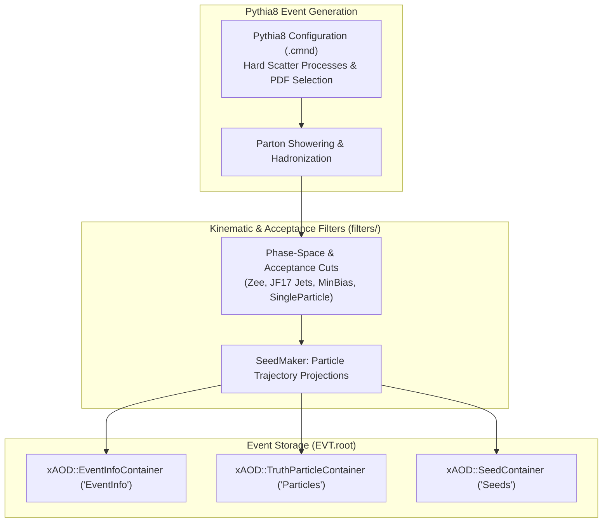

# Physics Event Generator Package

The `generator/` package is responsible for primary physics event simulation, parton showering, hadronization, kinematic filtering, and event record construction using **Pythia8** and **HepMC3** within the Lorenzetti framework.

---

## 1. Architecture & Pipeline



---

## 2. Event Generation Modes

| Generator Mode | Filter Class | Description |
| :--- | :--- | :--- |
| **$Z \to e^+e^-$** | `Zee` | Resonant $Z/\gamma^*$ production decaying to $e^+e^-$ pairs with configurable $p_T$ and $\eta$ cuts. |
| **QCD Dijets** | `JF17` / `Jets` | Filtered multi-jet interactions in defined transverse momentum bins ($17 < p_T < 35\text{ GeV}$). |
| **Minimum Bias / Pileup** | `Minbias` / `Pileup` | Inelastic non-diffractive $pp$ interactions for in-time and out-of-time pileup overlay. |
| **Single Particle Gun** | `SingleParticle` | Mono-energetic or flat-spectrum single electrons, photons, or pions for calorimeter calibration. |
| **Overlapped Events** | `OverlappedEvents` | Merges a hard-scatter process with $\langle\mu\rangle$ pileup background interactions. |

---

## 3. CLI Usage

All generation scripts are implemented using **`typer`** and provide rich diagnostics:

```bash
# Generate 1000 Z -> ee events
python generator/filters/scripts/gen_zee.py \
    --output-file EVT.root \
    --num-events 1000 \
    --min-pt 15000 \
    --eta-max 3.2

# Generate single electron gun calibration events
python generator/filters/scripts/gen_single.py \
    --output-file SingleElectron_EVT.root \
    --pdgid 11 \
    --energy-min 10000 \
    --energy-max 100000 \
    --num-events 5000
```
