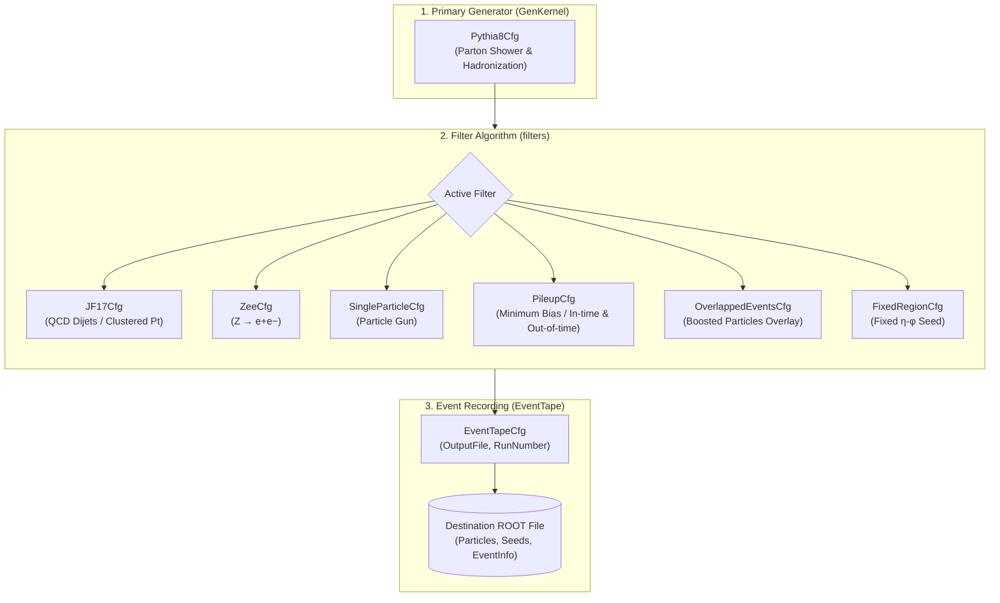
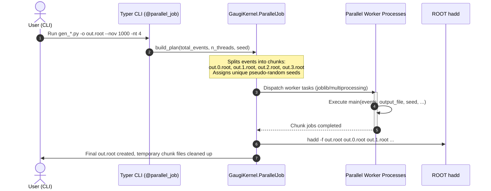

# Generator Filters Package (`generator/filters`)

The `generator/filters` package provides kinematic filtering algorithms, phase-space selection, single-particle injection, and event overlay helpers for the primary physics generator (**Pythia8**) within the **Lorenzetti** simulation framework.

---

## 1. Architecture & Execution Flow

### Event Filtering Pipeline



### Orchestration & Parallelism (`@parallel_job`)

All generation scripts utilize the `@parallel_job` decorator from `GaugiKernel`, pairing a **Typer** command-line interface with transparent multiprocessing chunk orchestration:



---

## 2. Available Filters & Configuration Parameters

All filters adhere to the **`*Cfg`** factory convention, returning a `Configurable` instance that exposes the underlying C++ algorithm through `.c_ptr()`.

---

### 2.1 `JF17Cfg` (QCD Dijet Filter)

Selects Pythia8 QCD dijet events within specified transverse momentum thresholds ($p_T > 17\text{ GeV}$), applying spatial clustering windows ($\eta, \phi$) and maximum electromagnetic fraction constraints.

#### Parameters

| Parameter | Type | Default | Description |
| :--- | :--- | :--- | :--- |
| `name` | `str` | `"JF17"` | Name of the algorithm instance. |
| `gen` | `Configurable` | `None` | Primary generator instance (`Pythia8Cfg`). |
| `EtaMax` | `float` | `1.4` | Maximum pseudorapidity $|\eta|$ for jet acceptance. |
| `EtaMin` | `float` | `0.0` | Minimum pseudorapidity $|\eta|$. |
| `MinPt` | `float` | `0.0` | Minimum transverse momentum cut (e.g. `17 * GeV`). |
| `Select` | `int` | `2` | Jet selection mode. |
| `EtaWindow` | `float` | `0.4` | $\eta$ window width for jet clustering. |
| `PhiWindow` | `float` | `0.4` | $\phi$ window width for jet clustering. |
| `MaxEMFraction` | `float` | `0.7` | Maximum allowed electromagnetic energy fraction in the jet. |
| `OutputLevel` | `int` | `INFO` | Logger verbosity level. |

#### Python Example

```python
from GaugiKernel import GeV, LoggingLevel
from GenKernel import Pythia8Cfg as Pythia8, EventTapeCfg as EventTape
from filters import JF17Cfg as JF17

tape = EventTape("EventTape", OutputFile="jets.root", RunNumber=1)

jets = JF17(
    "JF17",
    Pythia8("Generator", File="jet_config.cmnd", Seed=512),
    EtaMin=0.0,
    EtaMax=3.2,
    MinPt=17.0 * GeV,
    MaxEMFraction=0.7,
    EtaWindow=0.4,
    PhiWindow=0.4,
    OutputLevel=LoggingLevel.toC("INFO"),
)

tape += jets
tape.run(list(range(100)))
```

---

### 2.2 `ZeeCfg` ($Z \to e^+e^-$ Filter)

Filters resonant Drell-Yan / $Z$ boson decays into electron-positron pairs ($Z \to e^+e^-$), applying acceptance cuts and supporting calibration features (vertex zeroing and forward electron forcing).

#### Parameters

| Parameter | Type | Default | Description |
| :--- | :--- | :--- | :--- |
| `name` | `str` | `"Zee"` | Name of the algorithm instance. |
| `gen` | `Configurable` | `None` | Primary generator instance (`Pythia8Cfg`). |
| `EtaMax` | `float` | `1.4` | Maximum pseudorapidity $|\eta|$ accepted for electrons. |
| `MinPt` | `float` | `0.0` | Minimum transverse momentum cut for electrons (e.g. `15 * GeV`). |
| `ZeroVertexParticles` | `bool` | `False` | When `True`, fixes particle production vertex $z$-position to zero (calibration mode). |
| `ForceForwardElectron` | `bool` | `False` | Forces at least one electron/positron into the forward acceptance region. |
| `OutputLevel` | `int` | `INFO` | Logger verbosity level. |

#### Python Example

```python
from GaugiKernel import GeV
from GenKernel import Pythia8Cfg as Pythia8, EventTapeCfg as EventTape
from filters import ZeeCfg as Zee

tape = EventTape("EventTape", OutputFile="zee.root", RunNumber=1)

zee = Zee(
    "Zee",
    Pythia8("Generator", File="zee_config.cmnd", Seed=512),
    EtaMax=2.5,
    MinPt=15.0 * GeV,
    ZeroVertexParticles=False,
    ForceForwardElectron=False,
)

tape += zee
tape.run(list(range(100)))
```

---

### 2.3 `SingleParticleCfg` & `Particle` (Single Particle Gun)

Injects single particle events with custom energy regimes (mono-energetic or flat spectrum) and angular directions ($\eta, \phi$ fixed or ranged) for detailed calorimeter response studies and calibration.

#### `Particle` Enum

| Name | PDG ID |
| :--- | :--- |
| `Particle.Electron` | `11` |
| `Particle.Photon` | `22` |
| `Particle.PiPlus` | `211` |
| `Particle.PiZero` | `111` |
| `Particle.Neutrino` | `12` |

#### Parameters

| Parameter | Type | Default | Description |
| :--- | :--- | :--- | :--- |
| `name` | `str` | `"SingleParticle"` | Name of the algorithm instance. |
| `gen` | `Configurable` | `None` | Primary generator instance (`Pythia8Cfg`). |
| `Particle` | `int` | `Particle.Electron` | PDG ID of the generated particle. |
| `Energy` | `float` | `-1.0` | Exact fixed energy (if $< 0$, uses `EnergyMin`/`EnergyMax` interval). |
| `EnergyMin` | `float` | `0.0 * GeV` | Minimum energy for continuous spectrum generation. |
| `EnergyMax` | `float` | `100.0 * GeV` | Maximum energy for continuous spectrum generation. |
| `Eta` | `float` | `0.0` | Fixed $\eta$ position (when `DoRangedEta=False`). |
| `Phi` | `float` | `0.0` | Fixed $\phi$ position (when `DoRangedPhi=False`). |
| `DoRangedEta` | `bool` | `False` | Enables uniform sampling of $\eta$ in `[EtaMin, EtaMax]`. |
| `EtaMin` | `float` | `-2.5` | Lower bound for $\eta$ sampling range. |
| `EtaMax` | `float` | `2.5` | Upper bound for $\eta$ sampling range. |
| `DoRangedPhi` | `bool` | `False` | Enables uniform sampling of $\phi$ in `[PhiMin, PhiMax]`. |
| `PhiMin` | `float` | `-3.14` | Lower bound for $\phi$ sampling range. |
| `PhiMax` | `float` | `3.14` | Upper bound for $\phi$ sampling range. |
| `HasLifetime` | `bool` | `False` | Takes particle decay lifetime into account. |
| `AtRest` | `bool` | `False` | Generates particle at rest. |
| `OutputLevel` | `int` | `INFO` | Logger verbosity level. |

#### Python Example

```python
from GaugiKernel import GeV
from GenKernel import Pythia8Cfg as Pythia8, EventTapeCfg as EventTape
from filters import SingleParticleCfg as SingleParticle, Particle

tape = EventTape("EventTape", OutputFile="electrons.root", RunNumber=1)

single = SingleParticle(
    "SingleElectron",
    Pythia8("Generator", Seed=512),
    Particle=Particle.Electron,
    EnergyMin=10.0 * GeV,
    EnergyMax=100.0 * GeV,
    DoRangedEta=True,
    EtaMin=-2.5,
    EtaMax=2.5,
    DoRangedPhi=True,
    PhiMin=-3.14,
    PhiMax=3.14,
)

tape += single
tape.run(list(range(500)))
```

---

### 2.4 `PileupCfg` (Pileup / Minimum Bias Filter)

Simulates inelastic non-diffractive $pp$ interactions (Minimum Bias) overlaid across in-time and out-of-time bunch crossings around the nominal hard-scatter collision.

#### Parameters

| Parameter | Type | Default | Description |
| :--- | :--- | :--- | :--- |
| `name` | `str` | `"Pileup"` | Name of the algorithm instance. |
| `gen` | `Configurable` | `None` | Primary Minimum Bias generator instance (`Pythia8Cfg`). |
| `EtaMax` | `float` | `1.4` | Maximum pseudorapidity acceptance. |
| `PileupAvg` | `float` | `0.0` | Average collisions $\langle\mu\rangle$ per bunch crossing (Poisson distribution). |
| `PileupSigma` | `float` | `0.0` | Standard deviation for Gaussian pileup distribution. |
| `PileupPerBunch` | `float` | `-1.0` | Fixed number of pileup collisions per bunch crossing (if $> 0$). |
| `BunchIdStart` | `int` | `-8` | Starting bunch crossing index (past bunch crossings). |
| `BunchIdEnd` | `int` | `7` | Ending bunch crossing index (future bunch crossings). |
| `Select` | `int` | `2` | Selection filter mode. |
| `DeltaEta` | `float` | `0.22` | $\Delta\eta$ window around the seed. |
| `DeltaPhi` | `float` | `0.22` | $\Delta\phi$ window around the seed. |
| `OutputLevel` | `int` | `INFO` | Logger verbosity level. |

#### Python Example

```python
from GenKernel import Pythia8Cfg as Pythia8, EventTapeCfg as EventTape
from filters import PileupCfg as Pileup, FixedRegionCfg as FixedRegion

tape = EventTape("EventTape", OutputFile="pileup.root", RunNumber=1)

# Fixed seed to open event stream and record all pileup particles
tape += FixedRegion("Seed", Eta=0.0, Phi=0.0)

pileup = Pileup(
    "Pileup",
    Pythia8("MBGenerator", File="minbias_config.cmnd", Seed=512),
    EtaMax=3.2,
    PileupPerBunch=40.0,
    BunchIdStart=-21,
    BunchIdEnd=4,
    DeltaEta=999.0,
    DeltaPhi=999.0,
)

tape += pileup
tape.run(list(range(50)))
```

---

### 2.5 `OverlappedEventsCfg` (Particle Overlay / Boosted Topologies)

Overlays additional particles (such as collinear/boosted electrons) within a configurable angular separation cone $\Delta R = \sqrt{\Delta\eta^2 + \Delta\phi^2}$ relative to candidate seeds.

#### Parameters

| Parameter | Type | Default | Description |
| :--- | :--- | :--- | :--- |
| `name` | `str` | `"OverlappedEvents"` | Name of the algorithm instance. |
| `gen` | `Configurable` | `None` | Secondary generator instance (`Pythia8Cfg`). |
| `Particle` | `int` | `Particle.Electron` | PDG ID of the introduced overlay particle. |
| `Energy` | `float` | `1.0 * GeV` | Energy of the introduced particle. |
| `DeltaR` | `float` | `0.2` | Maximum angular distance $\Delta R$ from the seed particle. |
| `HasLifetime` | `bool` | `False` | Takes finite lifetime into account. |
| `AtRest` | `bool` | `False` | Generates particle at rest. |
| `OutputLevel` | `int` | `INFO` | Logger verbosity level. |

---

### 2.6 `FixedRegionCfg` (Fixed Seed Region)

Creates an artificial seed at predetermined $(\eta, \phi)$ coordinates, commonly used when unconstrained particle streams (like full Minimum Bias pileup) must be recorded without requiring a physics-triggered seed.

#### Parameters

| Parameter | Type | Default | Description |
| :--- | :--- | :--- | :--- |
| `name` | `str` | `"FixedRegion"` | Name of the algorithm instance. |
| `Eta` | `float` | `0.0` | Fixed $\eta$ position for the seed. |
| `Phi` | `float` | `0.0` | Fixed $\phi$ position for the seed. |
| `OutputLevel` | `int` | `INFO` | Logger verbosity level. |

---

## 3. CLI Executable Scripts (`generator/filters/scripts/`)

The generator scripts provide complete CLI interfaces built with **Typer** and automated chunk-level parallelization.

### 3.1 Common Parallelism Options (Available on All Scripts)

| Option | Short | Default | Description |
| :--- | :--- | :--- | :--- |
| `--output-file` | `-o` | *(Required)* | Destination ROOT output file. |
| `--nov`, `--number-of-events` | | `-1` | Total number of events to simulate. |
| `--number-of-threads` | `-nt` | `1` | Number of parallel worker processes. |
| `--events-per-job` | | `-1` | Events per chunk/process (computed automatically when `-1`). |
| `--seed` | `-s` | `512` | Base pseudo-random seed (each worker receives an independent seed). |
| `--event-numbers` | `-e` | `None` | Comma-separated list of event IDs (e.g. `'0,1,2,3'`). |
| `--merge` / `--no-merge` | `-m` | `True` | When enabled, merges chunk files using ROOT `hadd` upon completion. |
| `--overwrite` / `--no-overwrite` | | `True` | Overwrites existing output files. |
| `--dry-run` | | `False` | Displays the planned event chunks and seeds without launching generation. |
| `--job-file` | | `None` | JSON configuration file to pre-fill or override any CLI options. |

---

### 3.2 Command-Line Usage Examples

#### QCD Jet Generation (`gen_jets.py`)
```bash
python3 generator/filters/scripts/gen_jets.py \
    -o /data/jets.root \
    --nov 1000 \
    -nt 4 \
    --energy-min 17 \
    --eta-max 3.2
```

#### $Z \to e^+e^-$ Generation (`gen_zee.py`)
```bash
python3 generator/filters/scripts/gen_zee.py \
    -o /data/zee.root \
    --nov 500 \
    -nt 4 \
    --eta-max 2.5 \
    --force-forward-electron
```

#### Single Electron Gun (`gen_single.py`)
```bash
python3 generator/filters/scripts/gen_single.py \
    -o /data/single_electrons.root \
    --nov 2000 \
    -nt 8 \
    -p Electron \
    --energy-min 10 \
    --energy-max 100 \
    --do-eta-ranged \
    --eta-min -2.5 \
    --eta-max 2.5
```

#### Minimum Bias / Pileup Generation (`gen_minbias.py`)
```bash
python3 generator/filters/scripts/gen_minbias.py \
    -o /data/minbias.root \
    --nov 200 \
    -nt 4 \
    --pileup-per-bunch-crossing 30.0 \
    --bc-id-start -21 \
    --bc-id-end 4
```

#### Running with a Configuration File (`--job-file`)
```json
{
  "nov": 500,
  "number_of_threads": 4,
  "energy_min": 20.0,
  "eta_max": 2.5
}
```
```bash
python3 generator/filters/scripts/gen_jets.py -o /data/jets.root --job-file config.json
```
