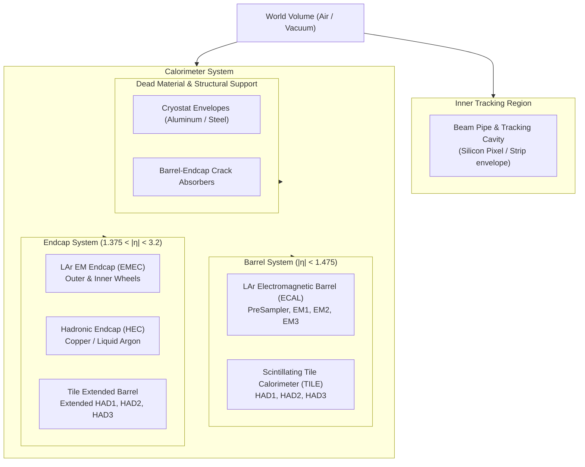

# Detector Geometry Package (`geometry/`)

The `geometry/` package implements the detector geometry description for the **Lorenzetti** simulation framework. It models a full-acceptance, high-granularity calorimeter system modeled after the **ATLAS** detector at the Large Hadron Collider (LHC), coupling a high-performance **Geant4** C++ engine (`DetectorConstruction_v1`) with flexible, modular Python volume builders.

---

## 1. Visual Overview

The detector model features fine $\eta \times \phi$ granularity, accordion/cell approximations, dead material cryostats, and forward endcaps:

| 3D Isometric Cutaway View | Frontal ($x-y$) Cross-Section |
| :---: | :---: |
|  |  |

| Longitudinal ($z-r$) Lateral Profile |
| :---: |
|  |

---

## 2. Geometry Hierarchy & Architecture



---

## 3. Subdetector Specifications

The geometry is partitioned into physical sampling layers matching the standard ATLAS calorimeter segmentation:

| Subdetector | Module Code | Material / Technology | Layers / Samplings | Acceptance Coverage |
| :--- | :--- | :--- | :--- | :--- |
| **LAr ECAL Barrel** | `LArBarrel` | Liquid Argon & Lead Absorber | PreSampler (PS), EM1, EM2, EM3 | $|\eta| < 1.475$ |
| **Tile Calorimeter** | `TileBarrel` | Iron Absorber & Plastic Scintillator Tiles | HAD1, HAD2, HAD3 | $|\eta| < 1.0$ |
| **Tile Extended** | `TileExtended` | Iron Absorber & Scintillator Tiles | ExtHAD1, ExtHAD2, ExtHAD3 | $0.8 < |\eta| < 1.7$ |
| **LAr EM Endcap** | `LArEMEC` | Liquid Argon & Lead Wheels | EMEC1, EMEC2, EMEC3 | $1.375 < |\eta| < 3.2$ |
| **Hadronic Endcap** | `HEC` | Copper Plates & Liquid Argon Gaps | HEC1, HEC2, HEC3, HEC4 | $1.5 < |\eta| < 3.2$ |
| **Cryostats & Crack**| `DeadMaterials`| Aluminum, Cables, Support Structures | Barrel/Endcap cryostats, crack absorbers | Full coverage |

---

## 4. Python Configuration API

The primary interface to construct and attach the detector model is `DetectorConstruction_v1`:

### `DetectorConstruction_v1` Parameters

| Parameter | Type | Default | Description |
| :--- | :--- | :--- | :--- |
| `name` | `str` | `"DetectorConstruction_v1"` | Identifier for the Geant4 detector construction instance. |
| `UseMagneticField` | `bool` | `False` | Enables central solenoidal magnetic field in tracking and calorimeter volumes. |
| `CutOnPhi` | `bool` | `False` | Slices the cylindrical geometry along $\phi$ (useful for fast simulation slices and 3D cutaway visualization). |

### Example Setup with `ComponentAccumulator`

```python
import ROOT
from G4Kernel import ComponentAccumulator
from geometry import DetectorConstruction_v1

# 1. Instantiate the detector construction
detector = DetectorConstruction_v1(
    "ATLASDetector",
    UseMagneticField=False,
    CutOnPhi=False,
)

# 2. Attach to the Geant4 ComponentAccumulator
acc = ComponentAccumulator(
    "ComponentAccumulator",
    detector,
    NumberOfThreads=4,
    Seed=512,
    OutputFile="G4Simulation.root",
)
```

---

## 5. Interactive 3D Visualization

The package includes an interactive visualization script located at [`geometry/scripts/run_vis.py`](scripts/run_vis.py) which initializes Geant4 with visualization drivers (e.g. Qt, OpenGL, or RayTracer):

```bash
# Run within Singularity container
python3 geometry/scripts/run_vis.py
```

This launches the interactive Geant4 visualizer, allowing rotation, zooming, layer peeling, and particle trajectory inspection.
