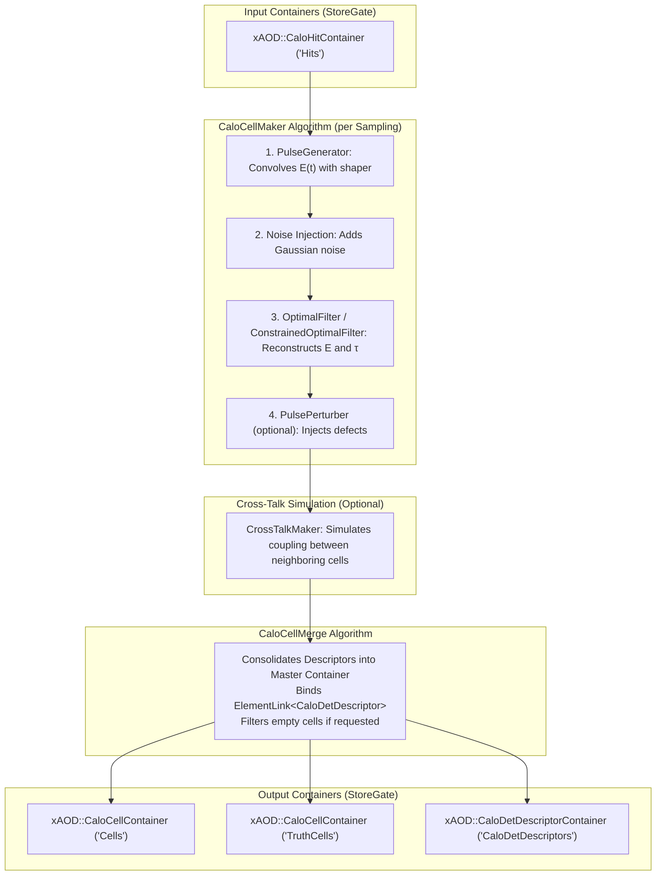

# CaloCellBuilder

The `CaloCellBuilder` package provides algorithms, tools, and configuration infrastructure for the complete **Calorimeter Digitization and Cell Reconstruction chain** in the Lorenzetti framework.

It converts simulated energy deposits (`xAOD::CaloHitContainer`) in sensitive calorimeter volumes into digitized readout cells (`xAOD::CaloCellContainer`), simulating electronic pulse shaping, noise injection, optimal filtering, cross-talk, and detector defects, while maintaining relational `ElementLink` references to a unified master descriptor container (`xAOD::CaloDetDescriptorContainer`).

---

## 1. Digitization Pipeline Architecture

The digitization chain executes event-by-event and sampling-by-sampling:



---

## 2. Algorithms and AlgTools

### Core Algorithms
* **`CaloCellMaker` (`C++`)**:
  Manages sampling-level digitization. Discretizes calorimeter geometry into $\eta$-$\phi$ cell descriptors, transfers hit bunch-crossing energy deposits, executes `PulseGenerator`, and invokes configured `AlgTool` filters.
* **`CaloCellMerge` (`C++`)**:
  Merges sampling descriptor collections into a master `xAOD::CaloDetDescriptorContainer` and unified reconstructed (`"Cells"`) and truth (`"TruthCells"`) containers. Establishes relational `ElementLink<xAOD::CaloDetDescriptor>` with lazy resolution capability.
* **`CrossTalkMaker` (`C++`)**:
  Simulates capacitive, inductive, and resistive cross-talk between neighboring cells in dense calorimeter layers (`EMB2`, `EMEC2`).

### AlgTools
* **`PulseGenerator` (`C++`)**:
  Convolves energy deposits with realistic shaper response curves and adds Gaussian noise.
* **`OptimalFilter` (`C++`)**:
  Estimates cell energy $E = \sum a_i S_i$ and time $\tau = \sum b_i S_i$ using precalculated OF weights.
* **`ConstrainedOptimalFilter` (`C++`)**:
  Constrained Optimal Filter (COF) for signal reconstruction in the Tile calorimeter.
* **`PulsePerturber` (`C++`)**:
  Injects detector defects (dead modules, abnormal noise levels) based on Bad Run List (BRL) specifications.

---

## 3. Configuration Flags

Global digitization flags are controlled via stringified enums:

### `CaloFlags`
* `SamplingnoiseStd` (`float`, default `0.0`): Global noise standard deviation.
* `DoCrossTalk` (`bool`, default `False`): Enables cell-to-cell cross-talk simulation.
* `DoCOF` (`bool`, default `False`): Enables Constrained Optimal Filtering for Tile calorimeter.
* `DoDefects` (`bool`, default `False`): Enables anomaly injection via `PulsePerturber`.

### `CrossTalkFlags`
* `MinEnergy` (`float`, default `1.0 * GeV`): Energy threshold to trigger cross-talk propagation.
* `AmpCapacitive` (`float`, default `4.2`): Capacitive coupling percentage.
* `AmpInductive` (`float`, default `2.3`): Inductive coupling percentage.
* `AmpResistive` (`float`, default `1.0`): Resistive coupling percentage.

### `AnomalyFlags`
* `BadRunListFile` (`str`, default `""`): Path to JSON file containing bad run and dead module definitions.

---

## 4. Python Configuration Interface

### `CaloCellBuilder` Class

```python
class CaloCellBuilder(Logger):
    def __init__(
        self,
        name: str,
        detector: Any,
        HistogramPath: str = "Expert",
        InputHitsKey: str = "Hits",
        OutputCellsKey: str = "Cells",
        OutputTruthCellsKey: str = "TruthCells",
        OutputDescriptorsKey: str = "CaloDetDescriptors",
        InputEventKey: str = "Events",
        FilterEmptyCells: bool = False,
        MinEnergy: float = 0.0,
        OutputLevel: int = LoggingLevel.toC("INFO"),
    ) -> None:
        ...
```

### Usage Example

```python
import ROOT
from GaugiKernel import LoggingLevel, ComponentAccumulator
from CaloCellBuilder import CaloCellBuilder, CaloFlags, CrossTalkFlags, AnomalyFlags

def configure_digitization(detector_construction: Any) -> ComponentAccumulator:
    acc = ComponentAccumulator("CaloDigitizationAcc")

    # 1. Set global flags
    CaloFlags.DoCrossTalk = True
    CaloFlags.DoDefects = False

    # 2. Instantiate and configure CaloCellBuilder
    cell_builder = CaloCellBuilder(
        name="CaloCellBuilder",
        detector=detector_construction,
        InputHitsKey="Hits",
        OutputCellsKey="Cells",
        OutputTruthCellsKey="TruthCells",
        OutputDescriptorsKey="CaloDetDescriptors",
        FilterEmptyCells=True,
        MinEnergy=0.0,  # Filter out empty cells
        OutputLevel=LoggingLevel.toC("INFO"),
    )

    # 3. Merge into the accumulator
    cell_builder.merge(acc)

    return acc
```

---

## 5. Dependencies
* `kernel/GaugiKernel`: Algorithm and AlgTool interfaces, StoreGate `EventContext`, Data Handles, `ElementLink`.
* `events/CaloCell`: `xAOD::CaloCell`, `xAOD::CaloDetDescriptor`, `xAOD::CaloCellContainer`, `xAOD::CaloDetDescriptorContainer`.
* `events/CaloHit`: `xAOD::CaloHitContainer`.
