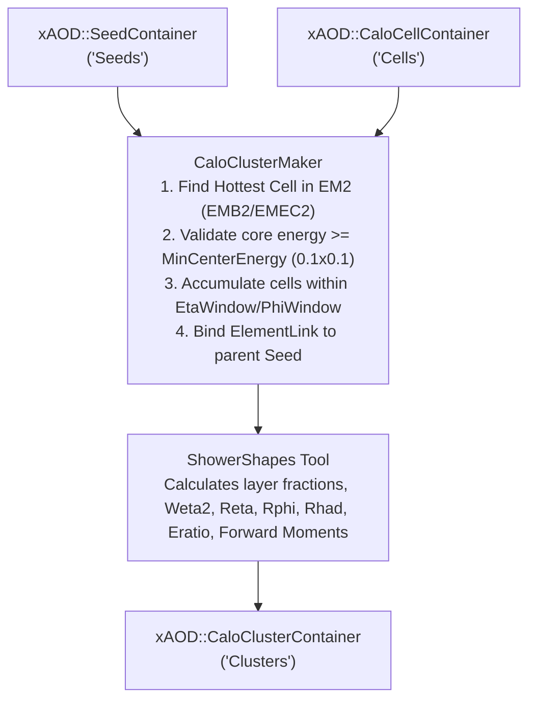

# CaloClusterBuilder

The `CaloClusterBuilder` package is responsible for reconstructing calorimeter clusters (`xAOD::CaloClusterContainer`) from digitized calorimeter cells (`xAOD::CaloCellContainer`) and initial particle trajectory projections (`xAOD::SeedContainer`), while computing lateral and longitudinal shower shape variables for electron and photon identification.

---

## 1. Reconstruction Pipeline Architecture

The seeded-clustering reconstruction pipeline executes event-by-event:



---

## 2. Algorithms and Tools

### `CaloClusterMaker` (`C++`)
* **Seed Processing**: Iterates through each particle seed in `xAOD::SeedContainer`.
* **Hottest Cell Scan**: Searches for the highest-energy cell in the second electromagnetic layer (`EMB2` or `EMEC2`) within a window of size $\Delta\eta < \text{EtaWindow}/2$, $\Delta\phi < \text{PhiWindow}/2$.
* **Core Energy Validation**: Evaluates whether the central $0.1 \times 0.1$ core energy around the hottest cell satisfies $E_{\text{core}} \ge \text{MinCenterEnergy}$.
* **Cell Accumulation**: Gathers all cells inside the $(\eta, \phi)$ window into the cluster's cell list.
* **Relational Linking**: Registers the parent seed in the cluster using `ElementLink<xAOD::Seed>` for persistent cross-referencing in ROOT trees.
* **Shower Shape Invocation**: Executes `ShowerShapes` to calculate discriminating variables.

### `ShowerShapes` (`C++`)
Utility `AlgTool` that populates cluster discriminating features:
* **Longitudinal Development**: `f0` (Pre-Sampler), `f1` (EM1), `f2` (EM2), `f3` (EM3), `ehad1`, `ehad2`, `ehad3`.
* **Lateral Development (EM2)**: `weta2` (shower width), `reta` ($E_{3\times7}/E_{7\times7}$), `rphi` ($E_{3\times3}/E_{3\times7}$).
* **Strip Development (EM1)**: `eratio` ($(E_{\text{max1}} - E_{\text{max2}})/(E_{\text{max1}} + E_{\text{max2}})$) for $\gamma / \pi^0$ separation.
* **Hadronic Leakage**: `rhad` ($E_{\text{had}}/E_{\text{EM}}$), `rhad1`.
* **Forward Moments (optional)**: `secondR`, `secondLambda`, `lambdaCenter`, `fracMax`, `lateralMom`, `longitudinalMom`.

---

## 3. Configuration Flags

Global cluster flags are controlled via `CaloClusterFlags`:

* **`MinCenterEnergy`** (`float`, default `1.0 * GeV`): Minimum core energy required around the hottest cell to form a cluster.
* **`EtaWindow`** (`float`, default `0.4`): Total $\eta$ window size ($\pm 0.2$).
* **`PhiWindow`** (`float`, default `0.4`): Total $\phi$ window size ($\pm 0.2$).
* **`DoForwardMoments`** (`bool`, default `False`): Flag to enable forward moment calculations for forward electrons.

---

## 4. Python Configuration

### `CaloClusterMakerCfg`

```python
def CaloClusterMakerCfg(
    name: str,
    InputCellsKey: str = "Cells",
    InputSeedsKey: str = "Seeds",
    OutputClusterKey: str = "Clusters",
    EtaWindow: float = CaloClusterFlags.EtaWindow,
    PhiWindow: float = CaloClusterFlags.PhiWindow,
    MinCenterEnergy: float = CaloClusterFlags.MinCenterEnergy,
    DoForwardMoments: bool = CaloClusterFlags.DoForwardMoments,
    OutputLevel: int = LoggingLevel.toC("INFO"),
    HistogramPath: str = "Expert/Clusters",
) -> Configurable:
    ...
```

### Usage Example

```python
import ROOT
from GaugiKernel import LoggingLevel, ComponentAccumulator
from GaugiKernel.constants import GeV
from CaloClusterBuilder import CaloClusterMaker, CaloClusterFlags

def configure_clustering(acc: ComponentAccumulator) -> None:
    output_level = LoggingLevel.toC("INFO")

    # 1. Configure CaloClusterMaker for reconstructed cells
    cluster_maker = CaloClusterMaker(
        "CaloClusterMaker",
        InputCellsKey="Cells",
        InputSeedsKey="Seeds",
        OutputClusterKey="Clusters",
        EtaWindow=0.4,
        PhiWindow=0.4,
        MinCenterEnergy=1.5 * GeV,
        DoForwardMoments=False,
        OutputLevel=output_level,
        HistogramPath="Expert/Clusters",
    )
    acc += cluster_maker

    # 2. (Optional) Configure CaloClusterMaker for truth cells
    truth_cluster_maker = CaloClusterMaker(
        "CaloClusterMaker_Truth",
        InputCellsKey="TruthCells",
        InputSeedsKey="Seeds",
        OutputClusterKey="TruthClusters",
        EtaWindow=0.4,
        PhiWindow=0.4,
        MinCenterEnergy=1.0 * GeV,
        DoForwardMoments=False,
        OutputLevel=output_level,
        HistogramPath="Expert/TruthClusters",
    )
    acc += truth_cluster_maker
```

---

## 5. Dependencies
* `core/GaugiKernel`: Algorithm and AlgTool base classes, StoreGate `EventContext`, Data Handles, `ElementLink`.
* `events/CaloCell`: `xAOD::CaloCell`, `xAOD::CaloCellContainer`, `xAOD::CaloDetDescriptor`.
* `events/EventInfo`: `xAOD::Seed`, `xAOD::SeedContainer`.
* `events/CaloCluster`: `xAOD::CaloCluster`, `xAOD::CaloClusterContainer`.
