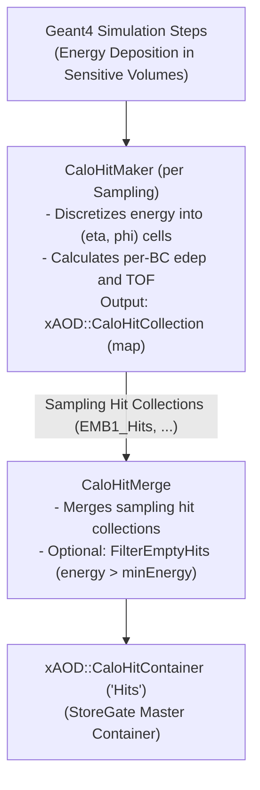

# CaloHitBuilder

The `CaloHitBuilder` package provides algorithms and configuration infrastructure for building and merging calorimeter hits during the Geant4 simulation step within the Lorenzetti framework.

---

## 1. Architecture Overview

During Geant4 simulation, particles deposit energy in sensitive calorimeter volumes across multiple bunch crossings (BC). `CaloHitBuilder` processes these energy deposits and converts them into structured Event Data Model (EDM) hits.



---

## 2. Algorithms

### `CaloHitMaker` (`C++`)
- Collects Geant4 energy steps deposited in sensitive volumes for a specific detector sampling.
- Maps step spatial coordinates to discretized $(\eta, \phi)$ cell indices and calculates cell hashes.
- Tracks energy deposition $E(t)$ and time-of-flight ($\text{TOF}$) across configured bunch crossing IDs (`bcid_start` to `bcid_end`).
- Records an `xAOD::CaloHitCollection` (a hash-indexed map of hits) into `SG::EventContext`.

### `CaloHitMerge` (`C++`)
- Reads individual `xAOD::CaloHitCollection` maps produced by `CaloHitMaker` instances across all active samplings.
- Aggregates hits into a single `xAOD::CaloHitContainer` (`SG::DataVector<xAOD::CaloHit>`).
- Supports hit filtering based on energy threshold to optimize memory and disk footprints.

#### Properties

| Property | Type | Default | Description |
| :--- | :--- | :--- | :--- |
| `InputCollectionKeys` | `std::vector<std::string>` | `{}` | List of StoreGate keys for input sampling collections. |
| `OutputHitsKey` | `std::string` | `"Hits"` | StoreGate key for the unified output container. |
| `FilterEmptyHits` | `bool` | `false` | When `true`, discards hits with energy $\le$ `MinEnergy`. |
| `MinEnergy` | `float` | `0.0` | Energy threshold (MeV) used when `FilterEmptyHits` is enabled. |
| `OutputLevel` | `int` | `1` | Logging verbosity (Gaugi message levels). |

---

## 3. Python Configuration

### `CaloHitMakerCfg`
Helper function returning a `Configurable` instance of `ROOT.CaloHitMaker` initialized with parameters from a geometry sampling descriptor.

```python
from CaloHitBuilder import CaloHitMakerCfg

hit_maker = CaloHitMakerCfg(
    "CaloHitMaker_EMB1",
    sampling=detector.samplings[0],
    OutputCollectionKey="EMB1_Hits",
    HistogramPath="Expert/EMB1",
    SamplingNoiseStd=0.0,
    DetailedHistograms=False,
)
```

### `CaloHitBuilder`
Coordinator class that hooks into `G4Kernel.ComponentAccumulator` to automatically instantiate `CaloHitMaker` for each sampling and `CaloHitMerge` for merging.

```python
from CaloHitBuilder import CaloHitBuilder
from G4Kernel import ComponentAccumulator

acc = ComponentAccumulator(detector=my_detector)

builder = CaloHitBuilder(
    "CaloHitBuilder",
    OutputHitsKey="Hits",
    FilterEmptyHits=True,
    MinEnergy=0.0,  # Discards zero-energy hits
)
builder.merge(acc)
```

---

## 4. Dependencies
- `core/GaugiKernel`: Algorithm interfaces, StoreGate `EventContext`, Data Handles, logging.
- `events/CaloHit`: `xAOD::CaloHit`, `xAOD::CaloHitCollection`, `xAOD::CaloHitContainer`.
- `simulation/G4Kernel`: Geant4 simulation context and `ComponentAccumulator`.
