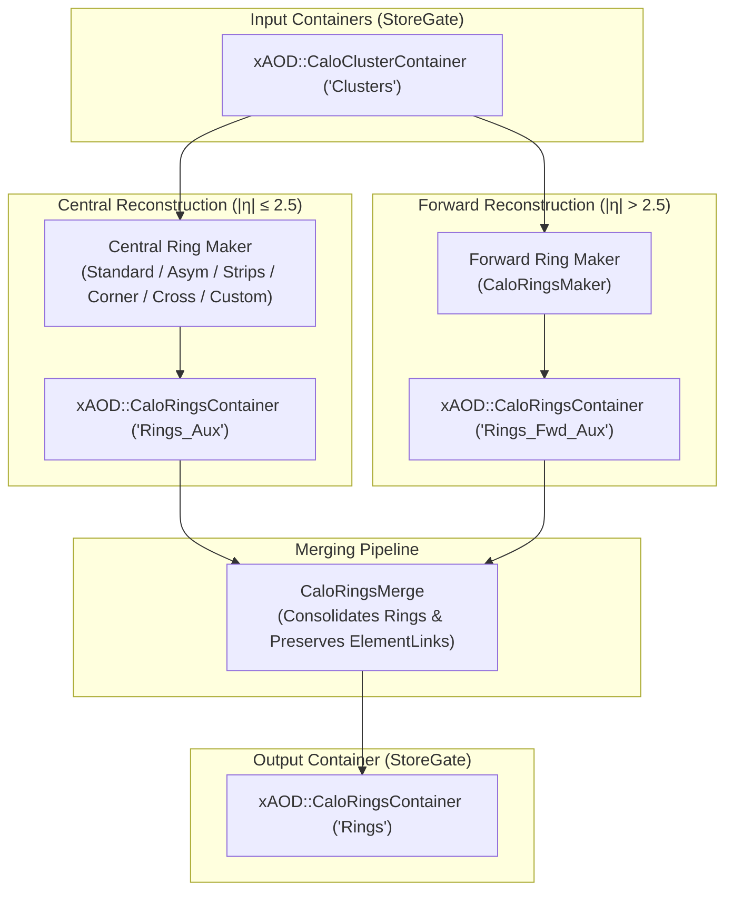

# CaloRingsBuilder

`CaloRingsBuilder` is a package designed to build concentric ring energy sums (known as **Rings** or **Ringer features**) from calorimeter clusters (`CaloCluster`). This representation compresses the detailed spatial energy deposits of a particle shower in the calorimeter into longitudinal and lateral profiles. These profiles are highly effective for fast electron/photon identification and trigger decision algorithms (e.g., using neural networks).

---

## Architecture & Data Flow



---

## How It Works

The `CaloRingsBuilder` processes clusters event-by-event and generates ring representations across different layers of the calorimeter. For each configured calorimeter layer:

1. **Center Identification**: It identifies the highest-energy ("hottest") cell belonging to the layer's samplings to act as the center ($\eta_{\text{center}}, \phi_{\text{center}}$) of the ring system. If no cell is found, it falls back to the cluster's barycenter ($\eta_{\text{cluster}}, \phi_{\text{cluster}}$).
2. **Cell Energy Accumulation**: For each cell in the cluster, it computes the distance to the center in $\eta$ and $\phi$ normalized by the ring granularities $\Delta\eta$ and $\Delta\phi$:
   $$d\eta = \frac{|\eta_{\text{center}} - \eta_{\text{cell}}|}{\Delta\eta}$$
   $$d\phi = \frac{|\text{diff}(\phi_{\text{center}}, \phi_{\text{cell}})|}{\Delta\phi}$$
   *(Note: $\text{diff}(\phi_1, \phi_2)$ handles the cyclic wrapping of the calorimeter $\phi$ coordinate).*
3. **Ring Assignment**: The cell's transverse energy ($E_T$) is calculated as:
   $$E_T = \frac{E_{\text{cell}}}{\cosh(|\eta_{\text{center}}|)}$$
   This energy is accumulated into the corresponding ring index $i$ determined by the active topology.
4. **Noise/Sigma Cut**: If enabled, cells with energy below a given threshold (e.g., $E_{\text{cell}} \le \sigma_{\text{cut}} \times \sigma_{\text{noise}}$) are ignored to suppress noise.

---

## Supported Topologies

The package supports six distinct ring topologies defined by the `CaloRingsTopology` enum:

### 1. Standard (`std`)
* **Class**: `ROOT.CaloRingsMaker`
* **Description**: Forms concentric rectangular rings. The ring index is computed as:
  $$i = \text{round}(\max(d\eta, d\phi))$$
* **Ring Count**: $N$ rings per layer.

### 2. Asymmetric (`asym`)
* **Class**: `ROOT.CaloAsymRingsMaker`
* **Description**: Divides each concentric ring (except the central ring $0$) into $4$ separate quadrants in the $\eta$-$\phi$ plane:
  * **Q1** ($\Delta\eta > 0, \Delta\phi > 0$): index $(R \times 4) - 3$
  * **Q2** ($\Delta\eta > 0, \Delta\phi < 0$): index $(R \times 4) - 1$
  * **Q3** ($\Delta\eta < 0, \Delta\phi < 0$): index $R \times 4$
  * **Q4** ($\Delta\eta < 0, \Delta\phi > 0$): index $(R \times 4) - 2$
* **Ring Count**: $(N-1) \times 4 + 1$ rings per layer.

### 3. Strips (`strips`)
* **Class**: `ROOT.CaloStripsRingsMaker`
* **Description**: Accumulates energy along a single axis (either $\eta$ or $\phi$), creating strip-like segments.
* **Configuration**: Controlled by the `Axis` parameter:
  * `0` (default): Strips along the $\eta$ axis.
  * `1`: Strips along the $\phi$ axis.

### 4. Corner (`corner`)
* **Class**: `ROOT.CaloCornerRingsMaker`
* **Description**: Spawns $4$ seed centers (centroids) shifted diagonally from the cluster center by $\pm(\text{CornerShift} \times \Delta\eta, \text{CornerShift} \times \Delta\phi)$. Cells accumulate energy relative to all $4$ corner seeds, creating four parallel ring profiles.
* **Ring Count**: $N \times 4$ rings per layer.

### 5. Cross (`cross`)
* **Class**: `ROOT.CaloCrossRingsMaker`
* **Description**: Similar to the `Corner` topology, but spawns $4$ seed centers shifted along the primary axes (Top, Bottom, Left, Right) by $\pm\text{CrossShift} \times \Delta\eta$ or $\pm\text{CrossShift} \times \Delta\phi$.
* **Ring Count**: $N \times 4$ rings per layer.

### 6. Custom (`custom`)
* **Class**: `ROOT.CaloCustomRingsMaker`
* **Description**: Allows spawning an arbitrary number of seed centers shifted by user-specified vectors: `RingsShiftEta` and `RingsShiftPhi`.
* **Ring Count**: $N \times \text{number of custom shifts}$ rings per layer.

---

## Python Configuration

The Python configuration is managed through the helper function `CaloRingsBuilderCfg` (also aliased to `CaloRingsBuilder` in `python/CaloRingsBuilder.py`).

### Function Signature
```python
def CaloRingsBuilderCfg(
    name              : str,
    InputClusterKey   : str,
    OutputRingerKey   : str,
    OutputLevel       : int   = 0,
    HistogramPath     : str   = "Expert/Rings",
    DoSigmaCut        : bool  = False,
    SigmaCut          : float = 2.0,
    RingerTopology    : CaloRingsTopology = CaloRingsTopology.Standard,
    CornerShift       : Optional[int]   = None,
    CrossShift        : Optional[int]   = None,
    RingsShiftEta     : Optional[List[float]] = None,
    RingsShiftPhi     : Optional[List[float]] = None,
    Axis              : Optional[int]   = None,
) -> List[Configurable]:
```

### Parameters
* **`name`** (`str`): Base name of the configuration tools.
* **`InputClusterKey`** (`str`): StoreGate key of the input `xAOD::CaloClusterContainer`.
* **`OutputRingerKey`** (`str`): StoreGate key for the final merged `xAOD::CaloRingsContainer`.
* **`OutputLevel`** (`int`, default `0`): Verbosity logging level.
* **`HistogramPath`** (`str`, default `"Expert/Rings"`): Path to book and save histograms.
* **`DoSigmaCut`** (`bool`, default `False`): Enable noise suppression cut.
* **`SigmaCut`** (`float`, default `2.0`): Threshold factor for the sigma noise cut.
* **`RingerTopology`** (`CaloRingsTopology`, default `Standard`): The ring topology to use.
* **`CornerShift`** (`Optional[int]`, default `None`): Shift magnitude in cell units for the `Corner` topology (defaults to `3` if `None`).
* **`CrossShift`** (`Optional[int]`, default `None`): Shift magnitude in cell units for the `Cross` topology (defaults to `3` if `None`).
* **`RingsShiftEta` / `RingsShiftPhi`** (`Optional[List[float]]`, default `None`): Custom shift vectors in cell units (defaults to `[0.0]` if `None`).
* **`Axis`** (`Optional[int]`, default `None`): Strips axis (`0` for $\eta$, `1` for $\phi$; defaults to `0` if `None`).

---

## Python Configuration Example

```python
import ROOT
from GaugiKernel import LoggingLevel, ComponentAccumulator
from CaloRingsBuilder import CaloRingsBuilderCfg, CaloRingsTopology

def configure_reconstruction_job():
    acc = ComponentAccumulator("RecoJobAccumulator", "output.AOD.root")
    output_level = LoggingLevel.INFO

    # Configure Standard Rings
    std_rings_tools = CaloRingsBuilderCfg(
        name="CaloRingsBuilder_Std",
        InputClusterKey="Clusters",
        OutputRingerKey="RingsL0",
        OutputLevel=output_level,
        HistogramPath="Expert/RingsL0",
        DoSigmaCut=True,
        SigmaCut=2.5,
        RingerTopology=CaloRingsTopology.Standard
    )
    
    for tool in std_rings_tools:
        acc.add(tool)

    return acc

if __name__ == "__main__":
    job_acc = configure_reconstruction_job()
    print("CaloRings configuration completed successfully!")
```
