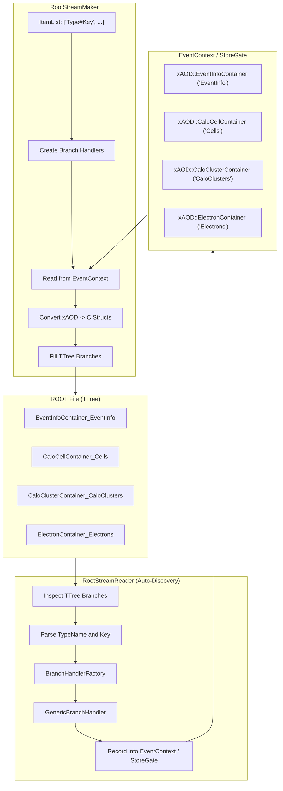

# RootStreamBuilder

The **RootStreamBuilder** package (`reconstruction/io/RootStreamBuilder`) is the central I/O (Input/Output) component of the Lorenzetti framework for persisting and retrieving EDM (`xAOD`) objects in ROOT files using `TTree`.

It provides a **generic, extensible, and data-driven** architecture:
- **`RootStreamReader`**: Smart reader with **automatic branch discovery**, inspecting the `TTree`, instantiating matching converters, and reconstructing all containers directly in `EventContext`/`StoreGate` without requiring manual per-tier configuration (HIT, ESD, AOD).
- **`RootStreamMaker`**: Generic writer configured via an item list (`ItemList`), serializing any requested `xAOD` container into standard `<TypeName>_<Key>` branches.
- **`RootStreamNtupleMaker`**: Analysis algorithm flattening physical variables and calorimetric shower rings into a flat `TTree` (`events`), ideal for neural network training (Ringer) and performance studies.

---

## 1. Architecture



---

## 2. C++ Components

| Class / Interface | Description |
| :--- | :--- |
| `IBranchHandler` | Polymorphic interface for binding, reading, and writing branches in the `TTree`. |
| `GenericBranchHandler<TContainer, TStruct, TConverter>` | Type-safe C++ template handler for any `xAOD` container type. |
| `BranchHandlerFactory` | Handler factory based on type name (`TypeName`), instantiating the correct template. |
| `RootStreamReader` | Algorithm that discovers branches dynamically from the input tree and registers containers. |
| `RootStreamMaker` | Algorithm that reads containers from `EventContext` specified in `ItemList` and fills the `TTree`. |
| `RootStreamNtupleMaker` | Analysis algorithm producing flat `TTree` structures (e.g. `cl_et`, `cl_rings`, etc.). |

---

## 3. Branch Naming Convention

All persistent branches follow the standard format:
```
<TypeName>_<Key>
```
Examples:
- `EventInfoContainer_EventInfo`
- `CaloCellContainer_Cells`
- `CaloClusterContainer_CaloClusters`
- `CaloRingsContainer_Rings`
- `ElectronContainer_Electrons`

---

## 4. Python Configuration

### 4.1. Automatic Reading (`RootStreamReader`)

With auto-discovery, there is no need to declare individual keys:

```python
from RootStreamBuilder import RootStreamReaderCfg

# Automatically reads all branches in the input ROOT file and TTree
reader = RootStreamReaderCfg(
    name="StreamReader",
    InputFile="output_aod.root",
    TreeName="CollectionTree"
)
```

### 4.2. Flexible Writing (`RootStreamMaker`)

Specify the containers to persist using `ItemList` with the `"TypeName#Key"` syntax:

```python
from RootStreamBuilder import RootStreamMakerCfg

writer = RootStreamMakerCfg(
    name="StreamAODMaker",
    ItemList=[
        "EventInfoContainer#EventInfo",
        "TruthParticleContainer#Particles",
        "CaloClusterContainer#CaloClusters",
        "CaloRingsContainer#Rings",
        "ElectronContainer#Electrons"
    ],
    TreeName="CollectionTree"
)
```

Convenience presets are also available for backward compatibility:
- `RootStreamAODMakerCfg(...)`
- `RootStreamESDMakerCfg(...)`
- `RootStreamHITMakerCfg(...)`

### 4.3. Flat Analysis Ntuples (`RootStreamNtupleMaker`)

```python
from RootStreamBuilder import RootStreamNtupleMakerCfg

ntuple_maker = RootStreamNtupleMakerCfg(
    name="NtupleMaker",
    InputEventKey="EventInfo",
    InputTruthKey="Particles",
    InputClusterKey="CaloClusters",
    InputRingerKeys=["Rings"],
    InputElectronKey="Electrons",
    OutputNtupleName="events"
)
```
