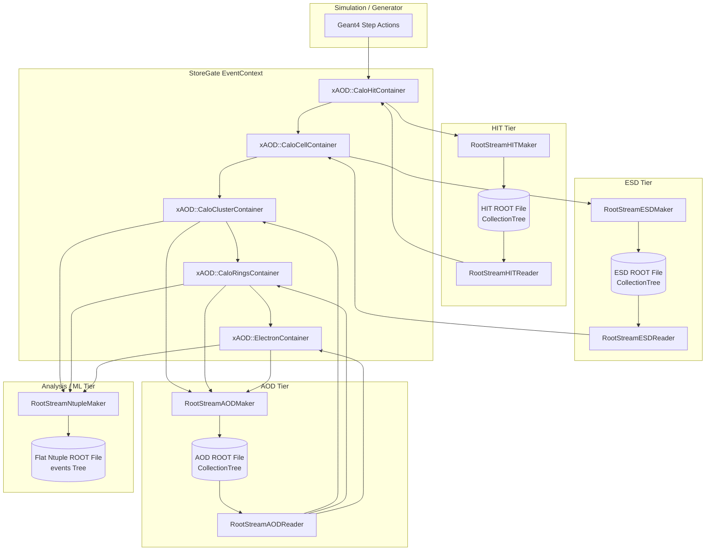

# RootStreamBuilder

`RootStreamBuilder` is an I/O serialization and deserialization package designed to stream event data between memory (StoreGate containers) and persistent ROOT TTree files at different data tiers (HIT, ESD, AOD, and Ntuple). It serves as the primary data interface for the Lorenzetti simulation and reconstruction chain.

---

## Architecture & Data Flow



---

## Data Tiers

The package supports four distinct event formats, each catering to different levels of analysis detail:

### 1. HIT Tier
* **Maker**: `RootStreamHITMaker` (via `RootStreamHITMakerCfg`)
* **Reader**: `RootStreamHITReader`
* **Description**: Handles the streaming of raw calorimeter hits (`CaloHit`), truth particles (`TruthParticle`), track seeds (`Seed`), and event headers (`EventInfo`).
* **Key Features**: Supports streaming only inside a Region of Interest (RoI) window via `OnlyRoI` flag to reduce file size.

### 2. ESD (Event Summary Data) Tier
* **Maker**: `RootStreamESDMaker` (via `RootStreamESDMakerCfg`)
* **Reader**: `RootStreamESDReader`
* **Description**: Streams detailed detector-level reconstruction outputs, including all calorimeter digitized cells (`CaloCell`), truth cell deposits (`CaloCellTruth`), track seeds, truth particles, and event headers. Necessary for detailed cell-level cluster studies.

### 3. AOD (Analysis Object Data) Tier
* **Maker**: `RootStreamAODMaker` (via `RootStreamAODMakerCfg`)
* **Reader**: `RootStreamAODReader`
* **Description**: Streams high-level reconstructed objects such as calorimeter clusters (`CaloCluster`), concentric rings (`CaloRings`), reconstructed electrons (`Electron`), track seeds, truth particles, and event headers. Persistent structs (`*_t`) preserve relational links via 64-bit string key hashing and container indices.

### 4. Ntuple Tier
* **Maker**: `RootStreamNtupleMaker` (via `RootStreamNtupleMakerCfg`)
* **Description**: Re-formats reconstructed analysis objects into a simplified, flat ROOT TTree format (typically named `events`). Designed for fast statistical plotting, machine learning model training (e.g. classification or anomaly detection), and trigger simulation.

---

## Configuration Flags

Default StoreGate keys and tier-specific parameters are managed via the following modules:

### 1. `RootStreamKeys`
Defines the standard StoreGate collection keys used throughout the data chain:
* `EventInfoKey` (default: `"EventInfo"`)
* `TruthParticleKey` (default: `"TruthParticles"`)
* `CaloCellsKey` (default: `"Cells"`)
* `CaloClustersKey` (default: `"CaloClusters"`)
* `ElectronsKey` (default: `"Electrons"`)

### 2. `RootStreamFlags`
* **`RootStreamHITFlags.OnlyRoI`** (`bool`, default `True`): Toggles whether to save hits only within the active Region of Interest (RoI).
* **`RootStreamESDFlags.EtaWindow` / `PhiWindow`** (`float`, default `0.4`): Dimensions of the RoI cone around seed centers.
* **`RootStreamAODFlags.DumpCells`** (`bool`, default `False`): Optionally streams raw cells alongside AOD physics objects.

---

## Python Configuration Examples

### Example 1: Writing ESD Data (Maker Job)
```python
import ROOT
from GaugiKernel import LoggingLevel, ComponentAccumulator
from RootStreamBuilder import RootStreamESDMakerCfg

def configure_esd_writer_job():
    acc = ComponentAccumulator("ESDWriterAccumulator", "output.ESD.root")
    output_level = LoggingLevel.INFO

    esd_writer = RootStreamESDMakerCfg(
        name="L0ESDStreamer",
        InputEventKey="EventInfo",
        InputTruthKey="TruthParticles",
        InputCellsKey="Cells",
        InputSeedsKey="Seeds",
        InputCellsTruthKey="TruthCells",
        OutputLevel=output_level,
        NtupleName="CollectionTree"
    )

    acc.add(esd_writer)
    return acc

if __name__ == "__main__":
    job_acc = configure_esd_writer_job()
    print("ESD Writer configured successfully!")
```

### Example 2: Reading AOD Data (Reader Job)
```python
import ROOT
from GaugiKernel import LoggingLevel, ComponentAccumulator
from RootStreamBuilder import RootStreamAODReader

def configure_aod_reader_job(input_file_path: str):
    acc = ComponentAccumulator("AODReaderAccumulator")
    output_level = LoggingLevel.INFO

    aod_reader = RootStreamAODReader(
        name="L0AODReader",
        InputFile=input_file_path,
        OutputEventKey="EventInfo",
        OutputTruthKey="TruthParticles",
        OutputClusterKey="CaloClusters",
        OutputRingerKeys=["RingsL0"],
        OutputRingerL0Key="RingsL0",
        OutputSeedsKey="Seeds",
        OutputElectronKey="Electrons",
        OutputTruthClusterKey="TruthClusters",
        OutputTruthRingerKeys=["TruthRingsL0"],
        OutputTruthElectronKey="TruthElectrons",
        OutputLevel=output_level,
        NtupleName="CollectionTree"
    )

    aod_reader.merge(acc)
    return acc

if __name__ == "__main__":
    job_acc = configure_aod_reader_job("input.AOD.root")
    print("AOD Reader configured successfully!")
```
