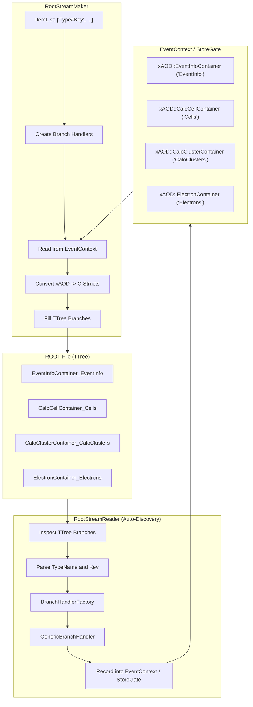
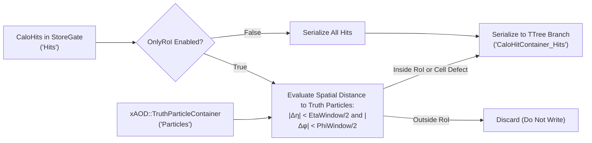
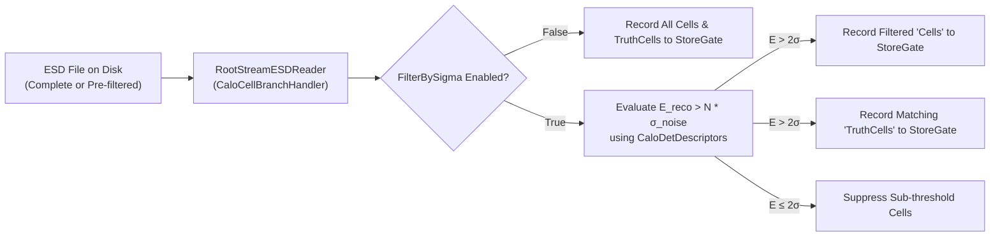

# RootStreamBuilder

The **RootStreamBuilder** package (`reconstruction/io/RootStreamBuilder`) is the central I/O (Input/Output) component of the Lorenzetti framework for persisting and retrieving EDM (`xAOD`) objects in ROOT files using `TTree`.

It provides a **generic, extensible, and data-driven** architecture:
- **`RootStreamReader`**: Smart reader with **automatic branch discovery**, inspecting the `TTree`, instantiating matching converters, and reconstructing all containers directly in `EventContext`/`StoreGate` without requiring manual per-tier configuration (HIT, ESD, AOD).
- **`RootStreamMaker`**: Generic writer configured via an item list (`ItemList`), serializing any requested `xAOD` container into standard `<TypeName>_<Key>` branches.
- **`RootStreamNtupleMaker`**: Analysis algorithm flattening physical variables and calorimetric shower rings into a flat `TTree` (`events`), ideal for neural network training (Ringer) and performance studies.

---

## 1. Architecture



---

## 2. C++ Components

| Class / Interface | Description |
| :--- | :--- |
| `IBranchHandler` | Polymorphic interface for binding, reading, and writing branches in the `TTree`. |
| `GenericBranchHandler<TContainer, TStruct, TConverter>` | Type-safe C++ template handler for any standard `xAOD` container type. |
| `CaloHitBranchHandler` | Specialized branch handler for `CaloHitContainer` supporting selective Region of Interest (RoI) filtering during serialization. |
| `BranchHandlerFactory` | Handler factory based on type name (`TypeName`), instantiating the correct template or specialized handler. |
| `RootStreamReader` | Algorithm that discovers branches dynamically from the input tree and registers containers. |
| `RootStreamMaker` | Algorithm that reads containers from `EventContext` specified in `ItemList` and fills the `TTree`. |
| `RootStreamNtupleMaker` | Analysis algorithm producing flat `TTree` structures (e.g. `cl_et`, `cl_rings`, etc.). |

---

## 3. Branch Naming Convention

All persistent branches follow the standard format:
```
<TypeName>_<Key>
```
Examples:
- `EventInfoContainer_EventInfo`
- `CaloCellContainer_Cells`
- `CaloClusterContainer_CaloClusters`
- `CaloRingsContainer_Rings`
- `ElectronContainer_Electrons`

---

## 4. Python Configuration

### 4.1. Automatic Reading (`RootStreamReader`)

With auto-discovery, there is no need to declare individual keys:

```python
from RootStreamBuilder import RootStreamReaderCfg

# Automatically reads all branches in the input ROOT file and TTree
reader = RootStreamReaderCfg(
    name="StreamReader",
    InputFile="output_aod.root",
    TreeName="CollectionTree"
)
```

### 4.2. Flexible Writing (`RootStreamMaker`)

Specify the containers to persist using `ItemList` with the `"TypeName#Key"` syntax:

```python
from RootStreamBuilder import RootStreamMakerCfg

writer = RootStreamMakerCfg(
    name="StreamAODMaker",
    ItemList=[
        "EventInfoContainer#EventInfo",
        "TruthParticleContainer#Particles",
        "CaloClusterContainer#CaloClusters",
        "CaloRingsContainer#Rings",
        "ElectronContainer#Electrons"
    ],
    TreeName="CollectionTree"
)
```

Convenience presets are also available for standard data tiers:
- `RootStreamAODMakerCfg(...)`
- `RootStreamESDMakerCfg(...)`
- `RootStreamHITMakerCfg(...)`

### 4.3. HIT Tier & Online Region of Interest (RoI) Filtering (`RootStreamHITMaker`)

During Geant4 detector shower simulation, particles shower extensively throughout the calorimeter, producing tens of thousands of energy deposits (`CaloHit`) across all layers and sampling cells. Persisting every detector hit indiscriminately results in massive file sizes (often gigabytes per job).

To solve this efficiently, `RootStreamBuilder` provides an **online RoI filtering strategy** implemented in `CaloHitBranchHandler`:



#### Key Architecture Principles:
* **Zero In-Memory Duplication**: Filtering is evaluated on the fly within `CaloHitBranchHandler::writeFromContext` directly during branch serialization. No temporary filtered collections are cloned into `StoreGate`.
* **Angular Modulo Correction**: $\Delta\phi$ calculation uses `CaloPhiRange::diff` to correctly handle azimuthal coordinate wrapping at $[-\pi, +\pi]$.
* **Hardware Defect Preservation**: An optional `CellHashes` list preserves designated detector channels (e.g., dead or hot cells) even if they lie outside all truth particle RoIs.

#### Configuration Options:
| Parameter | Type | Default | Description |
| :--- | :--- | :--- | :--- |
| `OnlyRoI` | `bool` | `True` | Toggles whether to filter hits within the RoI cone (`True`) or persist all detector hits (`False`). |
| `EtaWindow` | `float` | `0.4` | Full $\eta$ window size centered at each truth particle ($|\eta_{\text{hit}} - \eta_{\text{truth}}| < \Delta\eta / 2$). |
| `PhiWindow` | `float` | `0.4` | Full $\phi$ window size centered at each truth particle ($|\Delta\phi| < \Delta\phi / 2$). |
| `InputTruthKey` | `str` | `"Particles"` | StoreGate key of the truth particles providing RoI centroid coordinates. |
| `CellHashes` | `list[int]` | `[]` | Optional list of specific cell hashes to always persist. |

#### Usage Example (`simu_trf.py`):
```python
from RootStreamBuilder import RootStreamHITMakerCfg, recordable

# Save only hits inside the active Region of Interest (around truth particles)
hit_streamer = RootStreamHITMakerCfg(
    "RootStreamHITMaker",
    OutputLevel=output_level,
    OnlyRoI=not save_all_hits,  # True by default; False when --save-all-hits is passed
    EtaWindow=0.4,
    PhiWindow=0.4,
    InputHitsKey=recordable("Hits"),
    InputEventKey=recordable("Events"),
    InputTruthKey=recordable("Particles"),
    InputSeedsKey=recordable("Seeds"),
)
```

### 4.4. Flat Analysis Ntuples (`RootStreamNtupleMaker`)

```python
from RootStreamBuilder import RootStreamNtupleMakerCfg

ntuple_maker = RootStreamNtupleMakerCfg(
    name="NtupleMaker",
    InputEventKey="EventInfo",
    InputTruthKey="Particles",
    InputClusterKey="CaloClusters",
    InputRingerKeys=["Rings"],
    InputElectronKey="Electrons",
    OutputNtupleName="events"
)
```

### 4.5. ESD Tier & Online Noise Suppression Reading (`RootStreamESDReader` / ATLAS Run 4)

In offline reconstruction (`reco_trf.py`), `RootStreamESDReader` provides **on-the-fly cell noise filtering** ($E > N\sigma$, default $2\sigma$) via `CaloCellBranchHandler`.

This decouples the storage policy from reconstruction: a **single complete ESD** produced by `digit_trf.py` can be used to generate both Run 4 baseline AODs ($2\sigma$ cut) and control/calibration AODs (no cut or alternate thresholds) without repeating the CPU-intensive digitization step.



#### Key Advantages:
* **Workflow Efficiency**: Avoids re-running `digit_trf.py` to create separate ESD files for different cell energy thresholds.
* **Synchronized Truth**: `TruthCells` automatically matches the filtered real `Cells` container 1-to-1 in StoreGate.
* **Zero Algorithmic Changes Downstream**: `CaloClusterMaker`, `CaloRingsMaker`, and `ElectronMaker` transparently process the filtered cells from StoreGate.

#### Configuration Options:
| Parameter | Type | Default | Description |
| :--- | :--- | :--- | :--- |
| `FilterBySigma` | `bool` | `False` | Enables online cell noise suppression during read. |
| `SigmaThreshold` | `float` | `2.0` | Threshold multiplier for noise cut ($E > N\sigma$). |
| `DescriptorsKey` | `str` | `"CaloDetDescriptors"` | StoreGate key of master descriptor container. |

#### Usage Example (`reco_trf.py`):
```python
from RootStreamBuilder import RootStreamESDReader, recordable

ESD = RootStreamESDReader(
    "ESDReader",
    InputFile=input_file,
    OutputCellsKey=recordable("Cells"),
    OutputCellsTruthKey=recordable("TruthCells"),
    FilterBySigma=filter_by_sigma,     # Flag from CLI (--filter-by-sigma)
    SigmaThreshold=sigma_threshold,   # e.g., 2.0
    OutputLevel=outputLevel,
)
```

