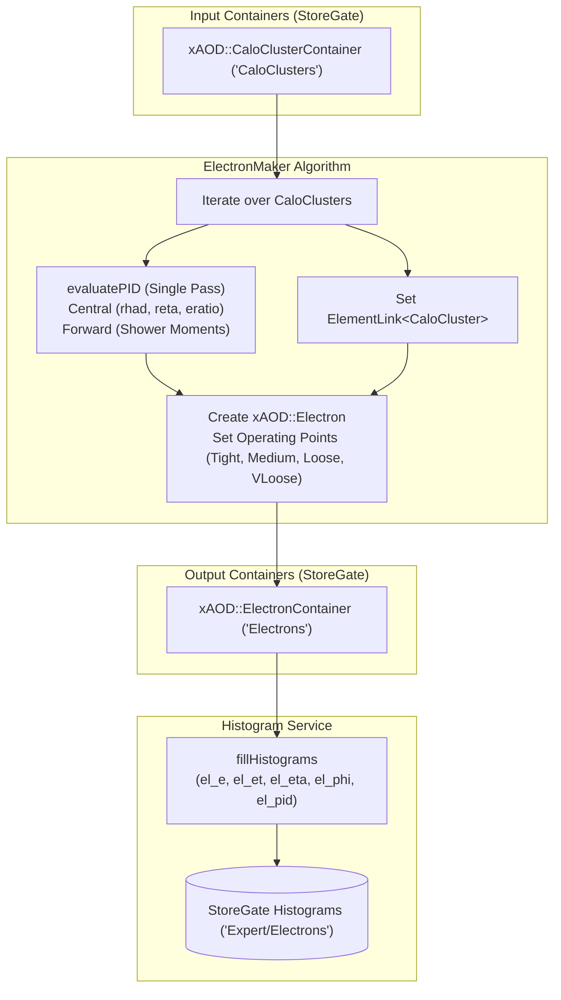

# EgammaBuilder

`EgammaBuilder` is a package designed for the reconstruction and identification of electron candidates from calorimeter clusters (`CaloCluster`) within the Lorenzetti framework. It applies cut-based electron identification (IsEM) criteria to classify candidates across multiple performance working points.

---

## Architecture & Data Flow



---

## How It Works

The `ElectronMaker` algorithm processes clusters event-by-event:

1. **Cluster Retrieval**: Reads a collection of `CaloCluster` candidates from StoreGate (`InputClusterKey`).
2. **Identification & Cut Evaluation (`evaluatePID`)**: For each cluster, evaluates all four operating points in a single pass:
   - **Central Region Selection** ($|\eta| \le 2.5$): Uses rectangular cuts on shower shape variables:
     - `rhad`: Hadronic leakage fraction ($E_{\text{had}} / E_{\text{EM}}$).
     - `reta`: Lateral shower shape parameter ($E_{3\times7} / E_{7\times7}$ in EM2).
     - `eratio`: Strip layer energy ratio ($ (E_{\text{max1}} - E_{\text{max2}}) / (E_{\text{max1}} + E_{\text{max2}}) $).
   - **Forward Region Selection** ($|\eta| > 2.5$): Employs cluster longitudinal/radial shower moments:
     - `secondLambda`: Second moment of the shower depth/lateral width.
     - `lateralMom`: Lateral energy distribution moment.
     - `longitudinalMom`: Longitudinal energy distribution moment.
     - `fracMax`: Energy fraction of the hottest cell.
     - `secondR`: Second radial moment.
     - `lambdaCenter`: Center of gravity depth of the shower.
3. **Electron Candidate Creation**: Reconstructs `xAOD::Electron` objects, binds them to parent clusters via lazy `ElementLink<CaloCluster>`, flags PID decisions, and records them in StoreGate (`OutputElectronKey`).
4. **Histograms & Monitoring**: Fills 1D control histograms (`el_e`, `el_et`, `el_eta`, `el_phi`, and `el_pid`) in StoreGate under `HistogramPath`.

---

## Supported Working Points & Central Cut Values

| Working Point | `rhad` Cut | `reta` Cut | `eratio` Cut |
| :--- | :--- | :--- | :--- |
| **`vloose`** | $\le 0.157$ | $\ge 0.752$ | $\ge 0.52$ |
| **`loose`** | $\le 0.1218$ | $\ge 0.57$ | $\ge 0.47$ |
| **`medium`** | $\le 0.0270375$ | $\ge 0.814625$ | $\ge 0.57$ |
| **`tight`** | $\le 0.0270375$ | $\ge 0.83125$ | $\ge 0.65$ |

---

## Python Configuration

The Python configuration is steered through the helper function `ElectronBuilderCfg` in `python/ElectronBuilder.py`.

### Function Signature
```python
def ElectronBuilderCfg(
    name             : str, 
    InputClusterKey  : str,
    OutputElectronKey: str,
    OutputLevel      : int = 0, 
    HistogramPath    : str = "Expert/Electrons",
) -> Configurable:
```

### Parameters
* **`name`** (`str`): Name of the `ElectronMaker` algorithm instance.
* **`InputClusterKey`** (`str`): StoreGate key of the input `xAOD::CaloClusterContainer`.
* **`OutputElectronKey`** (`str`): StoreGate key for the final reconstructed `xAOD::ElectronContainer`.
* **`OutputLevel`** (`int`, default `0`): Verbosity logging level.
* **`HistogramPath`** (`str`, default `"Expert/Electrons"`): Directory in StoreGate for histogram booking.

---

## Python Configuration Example

```python
import ROOT
from GaugiKernel import LoggingLevel, ComponentAccumulator
from EgammaBuilder import ElectronBuilderCfg, ElectronWorkingPoint

def configure_egamma_job():
    acc = ComponentAccumulator("EgammaJobAccumulator", "output.AOD.root")
    output_level = LoggingLevel.INFO

    # Configure the Electron Builder
    egamma_alg = ElectronBuilderCfg(
        name="L0ElectronBuilder",
        InputClusterKey="CaloClusters",
        OutputElectronKey="Electrons",
        OutputLevel=output_level,
        HistogramPath="Expert/Electrons",
    )
    
    acc.add(egamma_alg)
    return acc

if __name__ == "__main__":
    job_acc = configure_egamma_job()
    print("Electron reconstruction builder configured successfully!")
```
